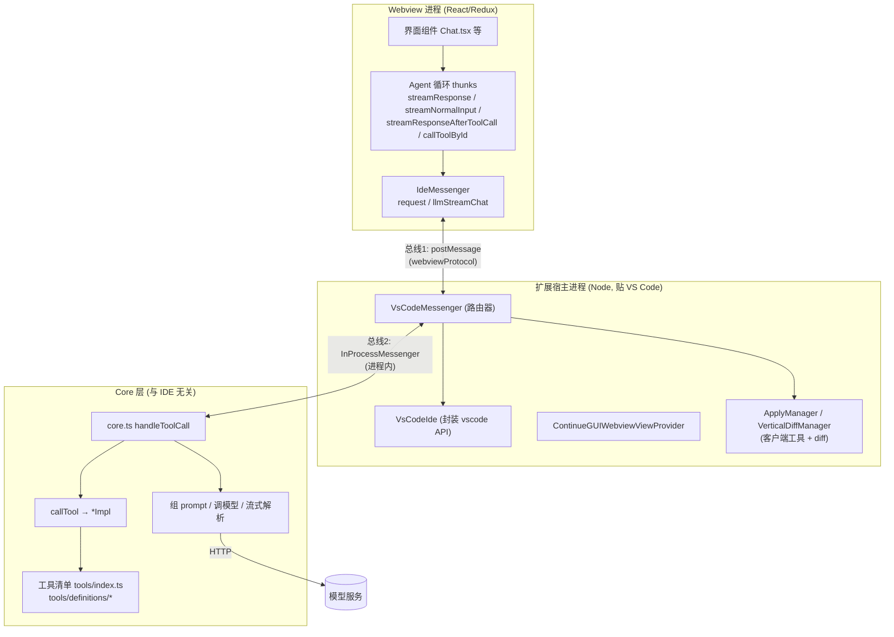
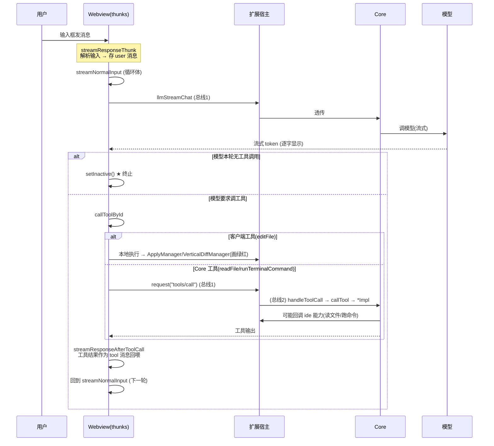

# Continue 整体架构总图（界面 + Harness）

> [!abstract] 一句话
> Continue = **三进程/三层**(Webview 界面 · 扩展宿主 · Core)+ **一个 Agent 循环**(harness)。界面负责交互与驱动循环,扩展宿主贴着 VS Code 提供能力,Core 是与 IDE 无关的业务大脑。本图把[[01-实现一个类Continue的带界面插件|界面/通信]]和[[02-Continue的Agent-Harness实现|Agent 循环]]两篇串成一张全景。

详见:[[01-实现一个类Continue的带界面插件]] · [[02-Continue的Agent-Harness实现]]

---

## 1. 三层 + 两条总线（静态结构）

| 层           | 跑在哪                    | 职责                                 | 代表文件                    |
| ------------ | ------------------------- | ------------------------------------ | --------------------------- |
| Webview 界面 | 独立沙箱进程              | UI + 驱动 Agent 循环                 | `gui/src/...`               |
| 扩展宿主     | Node 进程(有 vscode API)  | 贴 VS Code、路由消息、执行客户端工具 | `extensions/vscode/src/...` |
| Core         | 同扩展进程、但与 IDE 无关 | 业务大脑:工具执行、调模型            | `core/...`                  |

两条总线:

- **总线1 界面↔扩展**:`postMessage`(跨进程)—— `IdeMessenger` ↔ `VsCodeWebviewProtocol`
- **总线2 扩展↔Core**:`InProcessMessenger`(进程内,直接函数调用)

---

## 2. 一次完整对话的全景时序（动态流程）

---

## 3. 两篇笔记的对应关系

| 关注点                                                         | 看哪篇                                |
| -------------------------------------------------------------- | ------------------------------------- |
| 插件入口 / 激活 / Webview 注册 / 两条通信总线 / diff 渲染      | [[01-实现一个类Continue的带界面插件]] |
| Agent 循环入口 / 循环体 / 终止 / 工具调用链 / 工具清单在哪设置 | [[02-Continue的Agent-Harness实现]]    |

关键衔接点:

- **界面 → harness**:`Chat.tsx` 发送消息 `dispatch(streamResponseThunk)`(01 的界面 → 02 的循环入口)
- **harness → 界面能力**:`callToolById` 的客户端工具 → `ApplyManager`/`VerticalDiffManager` 画 diff(02 的工具 → 01 的 diff 渲染)
- **harness → Core**:`request("tools/call")` / `llmStreamChat` 走总线(02 的调用 → 01 的通信)

---

## 4. 一句话总结

Continue 是**三层(Webview 界面 / 扩展宿主 / Core)+ 两条总线(postMessage / InProcessMessenger)** 的架构,叠加一个**递归式 Agent 循环**:界面 `streamResponseThunk` 接收输入启动,`streamNormalInput` 调模型并判断是否调工具,工具由 `callToolById` 分流执行(客户端工具走扩展侧 diff,Core 工具走 `callTool`),结果经 `streamResponseAfterToolCall` 回喂后进入下一轮,直到模型不再请求工具而终止。可用工具清单在 `core/tools/index.ts` 组装、定义在 `core/tools/definitions/`。

## 5. 相关主题

- [[01-实现一个类Continue的带界面插件]]
- [[02-Continue的Agent-Harness实现]]
