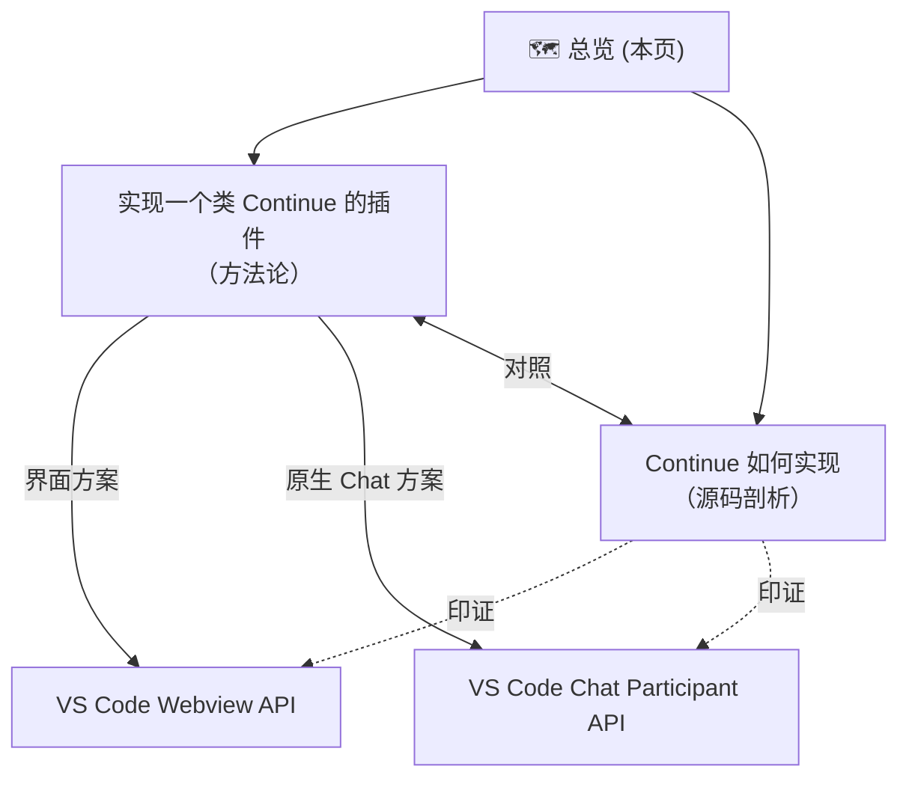

# 🗺️ VS Code AI 插件开发 · 总览 (MOC)

> [!abstract] 这是什么
> 这是「如何做一个类 Continue 的带界面 VS Code 插件」知识库的入口页（Map of Content）。它把四份笔记串起来，并给出按目标选择的阅读路径。

---

## 📚 文档清单

| 笔记                                          | 定位                 | 一句话                                                              |
| --------------------------------------------- | -------------------- | ------------------------------------------------------------------- |
| [[实现一个类 Continue 的带界面 VS Code 插件]] | 方法论               | 从零开始，要实现哪些接口/钩子的通用指南                             |
| [[Continue 如何实现 VS Code 的钩子与接口]]    | 源码剖析             | Continue 真实代码是怎么落地那些接口的                               |
| [[VS Code Webview API]]                       | 基础                 | 自建界面方案的底层 API                                              |
| [[VS Code Chat Participant API]]              | 基础                 | 复用原生 Chat 面板的底层 API                                        |
| [[Continue 的 Diff 生成与渲染]]               | 源码剖析             | 编辑文件从模型意图到行内绿/红高亮的全链路                           |
| [[改造 Continue 为右侧锁死 Chat 面板]]        | fork 定制 · 复现记录 | 禁用原生 chat + Continue 面板移到右侧并锁死,升级后照此复现          |
| [[构建与打包脚本速查]]                        | 工具 · 速查          | Continue(monorepo)与 VS Code fork 各自的编译/打包/启动命令          |
| [[Kiro 从 Continue 到自研的演变对照]]         | 逆向对照             | 对比两版 kiro-agent 清单,看 Kiro 如何从基于 Continue 演变到完全自研 |
| [[Kiro 的 ACP 工具与扩展方法清单]]            | 逆向对照 · 协议      | Kiro 三层工具路径、5 个 ClientCapabilityTool、120 个 `_kiro/*` 方法 |
| [[把 Continue 内置进 fork 发行版]]            | 发布 · 方案          | 下载即带 Continue 的产物内置方案(可行性/机制/风险,探讨阶段)         |

---

## 🧭 知识地图

---

## 🎯 按目标选择阅读路径

> [!tip] 我想**从零做一个插件**
>
> 1. [[实现一个类 Continue 的带界面 VS Code 插件]]（通读，照着 Checklist 走）
> 2. 做界面 → [[VS Code Webview API]]
> 3. 想接原生面板 → [[VS Code Chat Participant API]]
> 4. 卡住时参考 → [[Continue 如何实现 VS Code 的钩子与接口]] 的真实代码

> [!tip] 我想**读懂 Continue 源码**
>
> 1. [[Continue 如何实现 VS Code 的钩子与接口]]（主线，含映射表和源码位置）
> 2. 看不懂通信部分 → [[VS Code Webview API#4 通信：postMessage]]
> 3. 看不懂原生 Chat → [[VS Code Chat Participant API]]

> [!tip] 我只想**快速查某个接口**
> 直接看 [[Continue 如何实现 VS Code 的钩子与接口#3 核心映射表：Continue 实现了哪些 VS Code 接口]] 的速查表。

> [!tip] 我在维护**自己的 VS Code fork**（禁用原生 chat / 把 Continue 面板锁死在右侧）
> 直接看 [[改造 Continue 为右侧锁死 Chat 面板]]，它有逐文件的改动表、定位锚点和升级后的复现流程。

> [!tip] 我想**逆向 Kiro 的工具/协议设计**（给自己的 agent 做参考）
>
> 1. [[Kiro 从 Continue 到自研的演变对照]]——先看宏观演变路径
> 2. [[Kiro 的 ACP 工具与扩展方法清单]]——再看工具分三层、ClientCapabilityTool 的 `extMethod` 分发、120 个 `_kiro/*` 方法

---

## 🔑 核心概念速记

> [!note] 三条主线
>
> 1. **声明 + 实现**：`package.json`（清单，不执行）声明「有什么、何时唤醒」；代码 `register*` 才是实现。二者靠字符串 ID 契约绑定。
> 2. **三层两条总线**：Webview 前端 ↔（postMessage）↔ 扩展宿主 ↔（InProcessMessenger）↔ Core。`VsCodeMessenger` 做桥接。
> 3. **一个 Core，多种前端**：业务逻辑下沉到不依赖 `vscode` 的 Core，自建 Webview 和原生 Chat 都收口到它，便于跨 IDE 复用与测试。

---

## 🗂️ 关键源码位置（跨文档汇总）

| 概念                | 路径                                                                  |
| ------------------- | --------------------------------------------------------------------- |
| 扩展入口 `activate` | `extensions/vscode/src/extension.ts`                                  |
| 钩子集中注册        | `extensions/vscode/src/extension/VsCodeExtension.ts`                  |
| Webview Provider    | `extensions/vscode/src/ContinueGUIWebviewViewProvider.ts`             |
| 界面↔扩展协议      | `extensions/vscode/src/webviewProtocol.ts`                            |
| 扩展↔Core 桥接     | `extensions/vscode/src/extension/VsCodeMessenger.ts`                  |
| IDE 能力实现        | `extensions/vscode/src/VsCodeIde.ts`                                  |
| 原生 Chat 接入      | `extensions/vscode/src/activation/registerLanguageModelProvider.ts`   |
| 清单声明            | `extensions/vscode/package.json`                                      |
| 前端入口            | `gui/src/main.tsx` → `gui/src/App.tsx` → `gui/src/pages/gui/Chat.tsx` |

---

## ✅ 从零落地 Checklist（浓缩版）

> [!todo]
>
> - [ ] `package.json`：`main` + `activationEvents` + `contributes.views`
> - [ ] `extension.ts`：`activate` / `deactivate`
> - [ ] `registerWebviewViewProvider` + `resolveWebviewView` + `getHtml`
> - [ ] 前端：`acquireVsCodeApi()` + `postMessage` 收发
> - [ ] 通信协议：加 `messageId` 做请求-响应配对，支持流式
> - [ ] Core 层：模型调用与流式解析（不依赖 vscode）
> - [ ] 运行时钩子：`onDid*` 做上下文感知，记得 `subscriptions.push`
> - [ ] （可选）原生 Chat：`createChatParticipant` + `registerLanguageModelChatProvider`

---

#moc #vscode #continue
