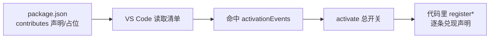
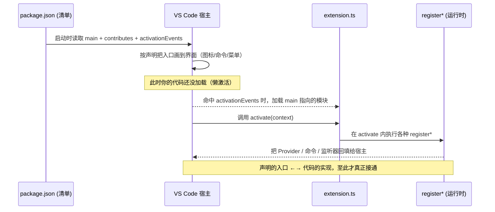
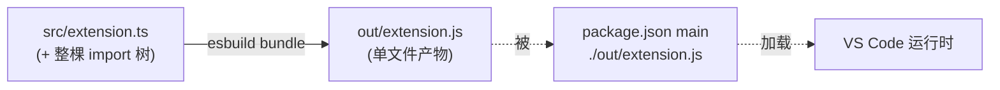
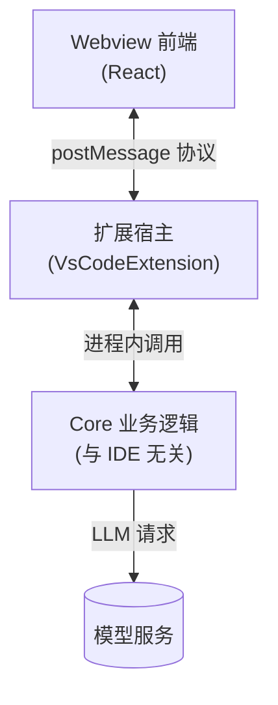

# 实现一个类 Continue 的带界面 VS Code 插件

> [!abstract] 一句话总结
> 用**标准 VS Code Extension API** 即可，不需要第三方框架。核心是：`activate()` 做入口 → `package.json` 的 `contributes` **声明**钩子 → 代码里 `register*` **实现**运行时钩子 → 界面用 **Webview** 承载一个独立的前端应用（Continue 用的是 React + Vite）→ 业务逻辑抽到一个与 IDE 无关的 **Core** 层。

相关源码参考：[[#附录-A-Continue-的文件对应关系]]

---

## 1. 技术选型（不需要框架）

| 维度           | Continue 的选择                    | 说明                                  |
| -------------- | ---------------------------------- | ------------------------------------- |
| 扩展 API       | `@types/vscode` + `engines.vscode` | 官方 API，无第三方框架                |
| 打包           | esbuild                            | 也可用 webpack / tsup                 |
| 界面           | React + Vite + Redux               | 任意前端框架都行，甚至纯 HTML         |
| 界面与宿主通信 | `postMessage` 协议                 | Webview 的标准机制                    |
| 业务逻辑       | 独立 Core 层                       | 便于跨 IDE（VS Code / JetBrains）复用 |

> [!tip]
> 界面框架是自由的。VS Code 只认 Webview 里的一段 HTML，HTML 里加载什么由你决定。

---

## 2. 必须实现的「两类钩子」

VS Code 的扩展点基本都是 **声明 + 实现** 两步：



> [!note]
> 这张是概览，下面 2.1.5 会把「谁调谁、入口在哪」拆成时序图细讲。

### 2.1 声明式（写在 `package.json` → `contributes`）

- [ ] `activationEvents` —— 何时激活（如 `onStartupFinished`、`onView:yourView`）
- [ ] `contributes.viewsContainers` —— 侧边栏/面板的容器图标
- [ ] `contributes.views` —— 把 **Webview 视图**挂进容器 ✅ _界面的关键_
- [ ] `contributes.commands` —— 命令
- [ ] `contributes.keybindings` —— 快捷键
- [ ] `contributes.menus` / `submenus` —— 右键菜单、标题栏按钮
- [ ] `contributes.configuration` —— 用户设置项

### 2.1.5 衔接：从清单到代码，VS Code 怎么找到你的 `register*`

> [!important] 声明只是「告诉 VS Code 有什么」，不等于「跑起来」
> `package.json` 里的 `contributes` 只是一份**静态清单**：VS Code 启动时读它，知道你声明了哪些视图、命令、快捷键，并把入口画到界面上（侧边栏图标、命令面板里的命令名等）。但此时你的 JS 代码**一行都还没执行**。真正把声明"接上"运行时逻辑，靠的是下面这条**懒加载激活链路**。

把 `package.json` 当作唯一入口，整条链路是这样的：



三个把两边"焊"在一起的关键约定：

| 清单里的声明（2.1）                                       | 代码里的实现（2.2）                                    | 靠什么对应上                                |
| --------------------------------------------------------- | ------------------------------------------------------ | ------------------------------------------- |
| `main`: `"out/extension.js"`                              | 该文件导出的 `activate` 函数                           | VS Code 加载 `main` 模块后调用其 `activate` |
| `activationEvents`                                        | 无（纯触发条件）                                       | 命中事件 → 才加载模块、才调 `activate`      |
| `contributes.views[].id` = `"myAgent.chatView"`           | `registerWebviewViewProvider("myAgent.chatView", ...)` | **viewType 字符串必须一模一样**             |
| `contributes.commands[].command` = `"myAgent.focusInput"` | `registerCommand("myAgent.focusInput", ...)`           | **command id 字符串必须一模一样**           |

> [!tip] 一句话记住
> **声明负责"占位"，`activate` 是总开关，`register*` 负责"填空"**；清单里的 `id` / `command` 字符串就是两边对接的"插销"，拼错一个字符，界面上就会出现"空视图"或"命令未找到"。

理解了这条链路，再看 2.2 的 `register*` 就清楚了：它们全都发生在 `activate(context)` 被调用**之后**，是对 2.1 声明的逐条兑现。

### 2.1.6 `main` 指向的 `out/extension.js` 是怎么构建出来的

> [!question] 为什么要搞清楚这个
> `package.json` 的 `main` 指向 `./out/extension.js`，但你**不会**去写它——它是压缩后的产物，一行难读。真正该读、该改的是 `src/extension.ts`。两者之间隔着一次 **esbuild 打包**，这节把这座桥补上。

**产物与源码的对应（两处配置互相印证）**

| 配置文件             | 字段          | 值                     | 作用                       |
| -------------------- | ------------- | ---------------------- | -------------------------- |
| `package.json`       | `main`        | `./out/extension.js`   | VS Code 运行时加载哪个文件 |
| `scripts/esbuild.js` | `entryPoints` | `["src/extension.ts"]` | 从哪个源码打包             |
| `scripts/esbuild.js` | `outfile`     | `out/extension.js`     | 打包到哪里                 |

`esbuild` 的 `outfile` 和 `package.json` 的 `main` 指向**同一个文件**，而它由 `entryPoints` 的 `src/extension.ts` 打包而来——这就是"源码入口是 `src/extension.ts`"的硬证据，不是靠约定猜的。



**esbuild 的关键配置（`scripts/esbuild.js`）**

```js
const esbuildConfig = {
  entryPoints: ["src/extension.ts"], // 源码入口
  outfile: "out/extension.js",       // 产物出口（= package.json main）
  bundle: true,                       // 把整棵依赖树打成一个文件
  platform: "node",                   // 扩展跑在 Node 宿主里
  format: "cjs",                      // VS Code 要求 CommonJS
  external: ["vscode", ...],          // vscode 由宿主提供，不打进产物
  sourcemap: flags.includes("--sourcemap"), // 带 --sourcemap 才生成 .map
  metafile: true,                     // 产出依赖分析，供可视化
};
```

几个要点：

- **`bundle: true`** 会把 `src/extension.ts` 顺着 `import` 把整棵依赖树（含 `core/*`）合并进一个 `out/extension.js`。所以产物里"一团压缩代码"其实是几十上百个源文件的集合。
- **`external: ["vscode", ...]`**：`vscode` 模块由编辑器宿主在运行时注入，**不能**打进产物，否则会和宿主的真实实现冲突。
- **`format: "cjs"` + `platform: "node"`**：VS Code 扩展宿主是 Node 环境、用 CommonJS 加载，所以不能打成 ESM/浏览器格式。

**对应的 npm 脚本（`package.json` → `scripts`）**

| 命令                    | 实际执行                 | 用途                                                   |
| ----------------------- | ------------------------ | ------------------------------------------------------ |
| `npm run esbuild`       | `esbuild.js --sourcemap` | 开发构建，**带 source map**（调试时能回到 `.ts`）      |
| `npm run esbuild-watch` | `… --sourcemap --watch`  | 监听源码变化，自动重打包                               |
| `vscode:prepublish`     | `esbuild.js --minify`    | 发布打包，**压缩、不带 map**（你看到的"压缩了"就是它） |

> [!tip] 「看不懂压缩代码」的解法，一句话
> 别读 `out/`。开发态用 `npm run esbuild`（带 `--sourcemap`，F5 调试会自动映射回 `.ts`）；要读逻辑直接看 `src/extension.ts` 这个 `entryPoints`。你当前看到的压缩版本，是 `vscode:prepublish` 的 `--minify` 产物。

> [!note] 顺带：产物体积分析
> 配置里 `metafile: true` 会把依赖分析写到 `build/meta.json`，再跑 `npm run esbuild:visualize` 能生成一张体积可视化图（`build/stats.html`），用来看是谁把产物撑大了。

### 2.2 命令式（写在代码里 `register*`）

- [ ] `activate(context)` / `deactivate()` —— 生命周期入口（**必须**）
- [ ] `vscode.window.registerWebviewViewProvider(...)` —— 渲染界面（**界面核心**）
- [ ] `vscode.commands.registerCommand(...)` —— 命令实现
- [ ] 各类 `vscode.workspace.onDid*` 事件监听

---

## 3. 做「带界面」的核心：Webview

> [!important] 这是实现界面的唯一关键接口
> `vscode.window.registerWebviewViewProvider(viewType, provider, options)`

### 3.1 package.json 声明

```jsonc
"contributes": {
  "viewsContainers": {
    "activitybar": [
      { "id": "myAgent", "title": "My Agent", "icon": "media/icon.svg" }
    ]
  },
  "views": {
    "myAgent": [
      { "type": "webview", "id": "myAgent.chatView", "name": "Chat" }
    ]
  }
}
```

### 3.2 实现 `WebviewViewProvider`

```ts
export class ChatViewProvider implements vscode.WebviewViewProvider {
  public static readonly viewType = "myAgent.chatView";

  constructor(private readonly extensionUri: vscode.Uri) {}

  resolveWebviewView(view: vscode.WebviewView) {
    view.webview.options = {
      enableScripts: true,
      localResourceRoots: [vscode.Uri.joinPath(this.extensionUri, "gui")],
    };
    view.webview.html = this.getHtml(view.webview);

    // 接收界面发来的消息
    view.webview.onDidReceiveMessage((msg) => {
      // 调用你的 Core 逻辑，再把结果 postMessage 回去
    });
  }

  private getHtml(webview: vscode.Webview): string {
    const scriptUri = webview.asWebviewUri(
      vscode.Uri.joinPath(this.extensionUri, "gui/assets/index.js"),
    );
    return /* html */ `<!DOCTYPE html>
      <html><body>
        <div id="root"></div>
        <script>const vscode = acquireVsCodeApi();</script>
        <script type="module" src="${scriptUri}"></script>
      </body></html>`;
  }
}
```

### 3.3 注册

```ts
export function activate(context: vscode.ExtensionContext) {
  const provider = new ChatViewProvider(context.extensionUri);
  context.subscriptions.push(
    vscode.window.registerWebviewViewProvider(
      ChatViewProvider.viewType,
      provider,
      { webviewOptions: { retainContextWhenHidden: true } }, // 隐藏时保留状态
    ),
  );
}
```

> [!note] 开发期热更新技巧（Continue 的做法）
> 开发模式下 `html` 里的 `src` 指向 Vite dev server（`http://localhost:5173/src/main.tsx`），生产模式才指向打包产物 `gui/assets/index.js`。这样改前端代码能热更新。

---

## 4. 界面 ↔ 扩展 ↔ Core 的通信

> [!abstract] 三层两条总线
> 这是 [[Continue]] 架构能跨 IDE 复用的关键。



| 总线   | 两端         | 机制                                          |
| ------ | ------------ | --------------------------------------------- |
| 总线 1 | 界面 ↔ 扩展 | `webview.postMessage` / `onDidReceiveMessage` |
| 总线 2 | 扩展 ↔ Core | 进程内 Messenger（直接函数调用）              |

界面侧发消息：

```ts
// 前端
const vscode = acquireVsCodeApi();
vscode.postMessage({ type: "chat/send", text: "你好" });
window.addEventListener("message", (e) => {
  if (e.data.type === "chat/token") appendToUI(e.data.text);
});
```

> [!tip] 建议抽象出 Core 层
> 把「组织 prompt、调用模型、流式解析、工具调用」等逻辑放进一个不依赖 `vscode` 的模块。好处：单元测试简单，将来移植到 JetBrains / CLI 时能直接复用。

---

## 5. 常用运行时钩子（按需实现）

> [!info] 这些让插件「感知编辑器」，是体验的关键

| 钩子                                                    | 用途                                               |
| ------------------------------------------------------- | -------------------------------------------------- |
| `vscode.commands.registerCommand`                       | 命令（配合快捷键，如 `Ctrl+L` 把选中代码加入对话） |
| `vscode.languages.registerInlineCompletionItemProvider` | Tab 自动补全                                       |
| `vscode.languages.registerCodeLensProvider`             | 代码上方的「应用 / 接受 diff」按钮                 |
| `vscode.workspace.onDidChangeTextDocument`              | 监听编辑，做索引/下一步编辑预测                    |
| `vscode.workspace.onDidSaveTextDocument`                | 保存时更新索引                                     |
| `vscode.workspace.onDidChangeActiveTextEditor`          | 跟踪当前文件作为上下文                             |
| `vscode.window.onDidChangeTextEditorSelection`          | 跟踪选区                                           |
| `vscode.workspace.onDidChangeConfiguration`             | 配置变更时重载                                     |
| `vscode.workspace.registerTextDocumentContentProvider`  | 只读虚拟文档（展示 diff）                          |

> [!warning] 释放资源
> 所有 `register*` / `onDid*` 返回的 `Disposable` 都要 `context.subscriptions.push(...)`，否则重载扩展会泄漏监听器。

---

## 6. 可选：接入 VS Code 原生 Chat 面板

如果你不想自己做 Webview 界面，而想复用 VS Code 1.90+ 内置的 Chat UI（即右侧原生聊天面板），走另一条路（需在 `enabledApiProposals` 里开启 proposed API）：

- `vscode.chat.createChatParticipant(id, handler)` —— 注册一个「聊天参与者」
- `vscode.lm.registerLanguageModelChatProvider(vendor, provider)` —— 注册语言模型
  - `provideLanguageModelChatInformation` 声明模型能力
  - `provideLanguageModelChatResponse` 流式返回
  - `provideTokenCount` 估算 token

> [!note]
> Continue 这个 fork（micat-agent）**两条路都走了**：既有自己的 React Webview 侧边栏，也桥接了 VS Code 原生 Chat 面板。普通项目二选一即可。

两种方案对比：

| 方案                  | 优点                              | 缺点                       |
| --------------------- | --------------------------------- | -------------------------- |
| 自建 Webview          | UI 完全自定义，跨 IDE 一致        | 要自己写全部界面           |
| 原生 Chat Participant | 省去界面开发，与 Copilot 面板统一 | UI 受限，依赖 proposed API |

---

## 7. 最小落地清单（Checklist）

> [!todo] 从零到可运行
>
> - [ ] `package.json`：`main`、`activationEvents`、`contributes.viewsContainers` + `contributes.views`
> - [ ] `extension.ts`：实现 `activate` / `deactivate`
> - [ ] `WebviewViewProvider`：`resolveWebviewView` + `getHtml` + `onDidReceiveMessage`
> - [ ] 前端应用：`acquireVsCodeApi()` + `postMessage` 收发
> - [ ] 打包：esbuild 打扩展，Vite 打前端，产物放进 `gui/`
> - [ ] 一个命令（如「聚焦输入框」）+ 快捷键
> - [ ] （可选）Core 层：模型调用与流式解析
> - [ ] （可选）编辑器事件监听做上下文感知

---

## 附录 A: Continue 的文件对应关系

| 概念                  | Continue 源码位置                                                   |
| --------------------- | ------------------------------------------------------------------- |
| 扩展入口 `activate`   | `extensions/vscode/src/extension.ts`                                |
| 钩子集中注册          | `extensions/vscode/src/extension/VsCodeExtension.ts`                |
| Webview 视图 Provider | `extensions/vscode/src/ContinueGUIWebviewViewProvider.ts`           |
| 界面↔扩展协议        | `extensions/vscode/src/webviewProtocol.ts`                          |
| 扩展↔Core 桥接       | `extensions/vscode/src/extension/VsCodeMessenger.ts`                |
| 命令注册              | `extensions/vscode/src/commands.ts`                                 |
| 原生 Chat 接入        | `extensions/vscode/src/activation/registerLanguageModelProvider.ts` |
| 清单声明              | `extensions/vscode/package.json` → `contributes`                    |
| 前端入口              | `gui/index.html` → `gui/src/main.tsx` → `gui/src/App.tsx`           |
| 聊天页面              | `gui/src/pages/gui/Chat.tsx`                                        |

## 附录 B: 相关主题

- [[VS Code Webview API]]
- [[VS Code Chat Participant API]]
- [[Continue 架构]]
- [[esbuild 打包 VS Code 扩展]]
