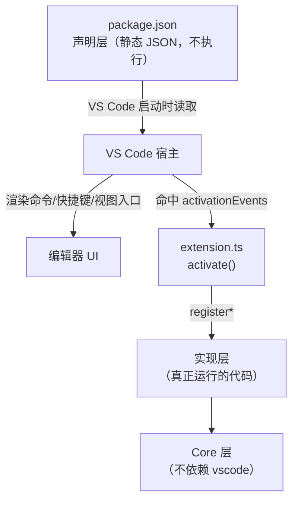
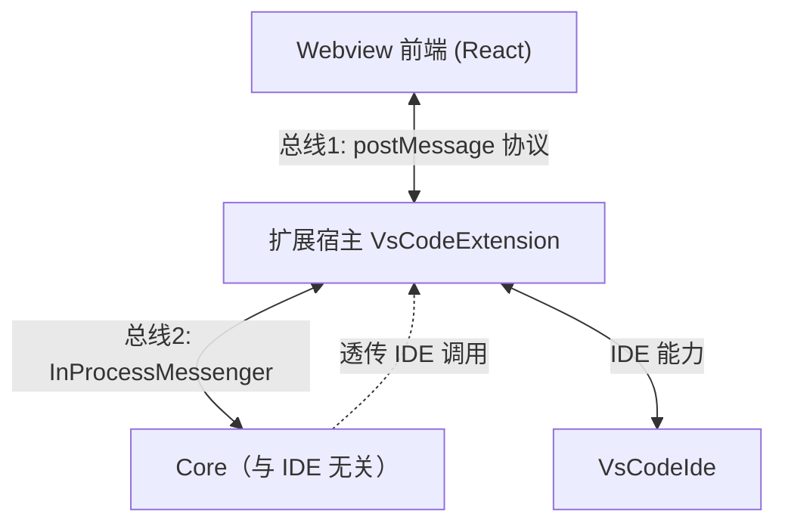
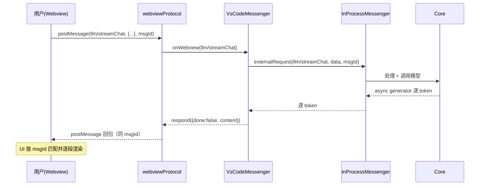

# Continue 如何实现 VS Code 的钩子与接口

> [!abstract] 核心结论
> Continue 用的是**纯标准 VS Code Extension API**，没有第三方框架。它遵循 VS Code「**声明（package.json）+ 实现（代码 register\*）**」的两段式模型：清单声明「有什么、何时唤醒」，`activate()` 被唤醒后用 `register*` 把真正的实现挂上去，业务逻辑则全部下沉到一个与 IDE 无关的 **Core** 层。

---

## 1. 全景：声明层 vs 实现层

> [!important] 两件事要分清
> `package.json` 不执行任何逻辑，它是**清单（manifest）/契约**；代码才是**实现**。VS Code 在加载你的代码之前，先读清单来发现、渲染 UI 并决定何时唤醒你。



两层靠**字符串 ID 契约**绑定，例如视图：

- 声明：`contributes.views` 里 `id: "continue.continueGUIView"`
- 实现：`registerWebviewViewProvider("continue.continueGUIView", provider)`
- ID 不一致 → UI 出现但点了没反应。

---

## 2. 激活机制（唤醒开关）

### 2.1 入口 `activate` / `deactivate`

> 源码：`extensions/vscode/src/extension.ts`

```ts
export function activate(context: vscode.ExtensionContext) {
  initializeMicatAuthentication(context); // 1. 先注册轻量认证
  const continueRuntime = import("./activation/activate") // 2. 动态 import 延后加载重 Core
    .then(({ createContinueRuntime }) => createContinueRuntime(context));
  registerLanguageModelProvider(context, continueRuntime); // 3. 注册原生 Chat（不等 Core）
}
export function deactivate() {}
```

> [!tip] 工程技巧
> 用动态 `import()` 把重量级 Core 延后，先把界面/Chat 注册上，避免激活超时。

### 2.2 `activationEvents`：什么时候唤醒

```jsonc
"activationEvents": ["onUri", "onStartupFinished", "onView:continueGUIView"]
```

| 事件                     | 触发时机                       | 作用                                                     |
| ------------------------ | ------------------------------ | -------------------------------------------------------- |
| `onStartupFinished`      | VS Code 启动完成后自动         | 让后台服务（补全、索引、文件监听）尽早就绪，又不拖慢启动 |
| `onView:continueGUIView` | 用户打开该 id 的侧边栏视图     | 保证点开界面时 provider 已就位（保险）                   |
| `onUri`                  | 外部深链接 `vscode://...` 打开 | 接住登录回调 / 深链接                                    |
|                          |                                |                                                          |

> [!note]
> 三者是「或」关系，哪个先发生就由哪个激活，`activate()` 只执行一次。VS Code 1.74+ 会为 `commands`/`views` 等自动生成激活事件，所以这里只保留不能自动推导的几条。

---

## 3. 核心映射表：Continue 实现了哪些 VS Code 接口

> [!info] 速查
> 下表是本文档的「索引」，后面章节逐一展开。

| VS Code 接口 / 钩子                                 | Continue 实现位置                                          | 用途                           |
| --------------------------------------------------- | ---------------------------------------------------------- | ------------------------------ |
| `activate` / `deactivate`                           | `extension.ts`                                             | 扩展生命周期入口               |
| `window.registerWebviewViewProvider`                | `VsCodeExtension.ts` + `ContinueGUIWebviewViewProvider.ts` | 侧边栏聊天界面                 |
| `commands.registerCommand`                          | `commands.ts`（`registerAllCommands`）                     | 所有 `continue.*` 命令         |
| `languages.registerInlineCompletionItemProvider`    | `VsCodeExtension.ts` + `autocomplete/`                     | Tab 自动补全                   |
| `languages.registerCodeLensProvider`                | `lang-server/codeLens.ts`                                  | diff 的接受/拒绝按钮           |
| `languages.registerDocumentLinkProvider`            | `ConfigYamlDocumentLinkProvider.ts`                        | 配置文件里的链接               |
| `workspace.registerTextDocumentContentProvider`     | `VsCodeExtension.ts`                                       | 只读虚拟文档（展示 diff）      |
| `workspace.onDid*` 系列                             | `VsCodeExtension.ts`                                       | 文件/编辑/配置事件 → 通知 Core |
| `window.onDidChange*` 系列                          | `VsCodeExtension.ts`                                       | 编辑器/选区变化                |
| `authentication.onDidChangeSessions`                | `VsCodeExtension.ts`                                       | 登录状态变化重载配置           |
| `window.registerUriHandler`（经 `UriEventHandler`） | `stubs/uriHandler.ts`                                      | 深链接处理                     |
| `lm.registerLanguageModelChatProvider`              | `registerLanguageModelProvider.ts`                         | 接入原生 Chat 模型             |
| `chat.createChatParticipant`                        | `registerLanguageModelProvider.ts`                         | 原生 Chat 参与者               |
| `webview.postMessage` / `onDidReceiveMessage`       | `webviewProtocol.ts`                                       | 界面 ↔ 扩展通信               |

---

## 4. 界面接口：Webview

> 源码：`VsCodeExtension.ts`（注册）、`ContinueGUIWebviewViewProvider.ts`（实现）

### 4.1 注册

```ts
this.sidebar = new ContinueGUIWebviewViewProvider(
  this.windowId,
  this.extensionContext,
);
context.subscriptions.push(
  vscode.window.registerWebviewViewProvider(
    "continue.continueGUIView", // 对应 package.json 声明的 id
    this.sidebar,
    { webviewOptions: { retainContextWhenHidden: true } }, // 隐藏时保留状态
  ),
);
```

### 4.2 实现 `WebviewViewProvider`

`resolveWebviewView` 里把 HTML 填进去，`getSidebarContent` 区分开发/生产：

```ts
if (inDevelopmentMode) {
  scriptUri = "http://localhost:5173/src/main.tsx"; // 开发：Vite dev server 热更新
} else {
  scriptUri = panel.webview
    .asWebviewUri(vscode.Uri.joinPath(extensionUri, "gui/assets/index.js"))
    .toString(); // 生产：打包产物
}
```

HTML 注入通信句柄与宿主信息（供 React 读取）：

```ts
`<script>const vscode = acquireVsCodeApi();</script>
 <script>localStorage.setItem("ide", '"vscode"')</script>
 <script>window.windowId = "${this.windowId}"</script>`;
```

> [!note] 界面本体
> 这段 HTML 加载的是 `gui/src/main.tsx → App.tsx`，`App.tsx` 用 `createMemoryRouter` 把聊天页 `pages/gui/Chat.tsx` 挂在根路由。详见 [[实现一个类 Continue 的带界面 VS Code 插件]]。

---

## 5. 通信接口：三层两条总线



### 5.1 总线 1：界面 ↔ 扩展（`webviewProtocol.ts`）

在裸 `postMessage` 上加了 `messageType + messageId + 流式` 语义。

**发**：

```ts
send(messageType, data, messageId?) {
  const id = messageId ?? uuidv4();
  this.webview?.postMessage({ messageType, data, messageId: id });
  return id;
}
```

**收 + 流式**（聊天逐 token 返回的关键）：

```ts
if (response && typeof response[Symbol.asyncIterator] === "function") {
  let next = await response.next();
  while (!next.done) {
    // 边生成边回传
    respond({ done: false, content: next.value, status: "success" });
    next = await response.next();
  }
  respond({ done: true, content: next.value, status: "success" });
}
```

**请求-响应配对**：靠 `messageId` 把一次 `request()` 和它的回包对上。

### 5.2 总线 2：扩展 ↔ Core（`InProcessMessenger`）

```ts
this.inProcessMessenger = new InProcessMessenger<
  ToCoreProtocol,
  FromCoreProtocol
>();
this.core = new Core(this.inProcessMessenger, this.ide);
// 调 Core：
this.core.invoke("files/changed", { uris: [event.uri.toString()] });
```

### 5.3 桥接两条总线：`VsCodeMessenger.ts`

透传 + IDE 能力分发：

```ts
// 界面消息透传给 Core，再把结果带回
WEBVIEW_TO_CORE_PASS_THROUGH.forEach((t) =>
  this.onWebview(t, (msg) =>
    this.inProcessMessenger.externalRequest(t, msg.data, msg.messageId),
  ),
);

// Core 消息透传给界面
CORE_TO_WEBVIEW_PASS_THROUGH.forEach((t) =>
  this.onCore(t, (msg) => this.webviewProtocol.request(t, msg.data)),
);

// 界面和 Core 都能调用的 IDE 能力，统一委托 VsCodeIde
this.onWebviewOrCore("readFile", (msg) => ide.readFile(msg.data.filepath));
this.onWebviewOrCore("writeFile", (msg) =>
  ide.writeFile(msg.data.path, msg.data.contents),
);
this.onWebviewOrCore("getDiff", (msg) => ide.getDiff(msg.data.includeUnstaged));
this.onWebviewOrCore("runCommand", (msg) => ide.runCommand(msg.data.command));
```

> [!tip] 为什么要 Core 层
> `Core`/`VsCodeIde` 把「业务逻辑」与「IDE 操作」解耦。Core 不依赖 `vscode`，所以同一套逻辑能复用到 JetBrains、CLI，并且好测试。

---

## 6. 运行时钩子：感知编辑器

> 源码：`VsCodeExtension.ts` 构造函数，全部 `push` 进 `subscriptions`。

```ts
// Tab 自动补全
context.subscriptions.push(
  vscode.languages.registerInlineCompletionItemProvider(
    [{ pattern: "**" }], this.completionProvider));

// 编辑/保存/删除/新建 → 通知 Core 更新索引
vscode.workspace.onDidChangeTextDocument(async (e) => { /* ... */ this.core.invoke("files/smallEdit", editInfo); });
vscode.workspace.onDidSaveTextDocument((e) => this.core.invoke("files/changed", { uris: [e.uri.toString()] }));
vscode.workspace.onDidDeleteFiles((e)   => this.core.invoke("files/deleted", { uris: /* ... */ }));
vscode.workspace.onDidCreateFiles((e)   => this.core.invoke("files/created", { uris: /* ... */ }));

// 当前文件 / 选区作为上下文
this.ide.onDidChangeActiveTextEditor((fp) => this.core.invoke("files/opened", { uris: [fp] }));
vscode.window.onDidChangeTextEditorSelection((e) => selectionManager.handleSelectionChange(e));

// 配置变更重载
vscode.workspace.onDidChangeConfiguration(async (e) => { /* 同步 ideSettings / next edit */ });

// 登录状态变化重载配置
vscode.authentication.onDidChangeSessions((e) => {
  if (e.provider.id === "github") this.configHandler.reloadConfig("Github sign-in status changed");
});

// 只读虚拟文档（展示 diff）
context.subscriptions.push(
  vscode.workspace.registerTextDocumentContentProvider(
    VsCodeExtension.continueVirtualDocumentScheme, documentContentProvider));
```

> [!warning] 释放资源
> 所有 `register*` / `onDid*` 返回的 `Disposable` 必须 `context.subscriptions.push(...)`，否则重载扩展会泄漏监听器。

此外还用 `fs.watchFile` 监听 `config.json/yaml/ts` 与全局 rules 目录的变化来重载配置（这是 Node 的能力，不是 vscode API，但同属「感知变化」的范畴）。

---

## 7. 可选接口：接入 VS Code 原生 Chat

> 源码：`activation/registerLanguageModelProvider.ts`。需在 `package.json` 的 `enabledApiProposals` 开启 proposed API。

```ts
// 1) 语言模型 provider
vscode.lm.registerLanguageModelChatProvider(
  "micatcode",
  new MicatLanguageModelProvider(continueRuntime),
);
//   - provideLanguageModelChatInformation() 声明模型能力
//   - provideLanguageModelChatResponse(...)  流式返回
//   - provideTokenCount(...)                 估算 token

// 2) Chat 参与者
vscode.chat.createChatParticipant(
  "micatcode.chat",
  async (request, ctx, response, token) => {
    await streamNativeAgentChat(
      continueRuntime,
      [{ role: "user", content: request.prompt }],
      requestId,
      token,
      response,
    );
  },
);
```

把 Core 的 agent 事件映射成原生 Chat UI：

```ts
case "text":       response.markdown(event.text); break;
case "thinking":   response.thinkingProgress({ id: requestId, text: event.text }); break;
case "tool-start": response.push(new vscode.ChatToolInvocationPart(/* ... */)); break;
```

> [!note] 两条路，一个 Core
> 自建 Webview 和原生 Chat 最终都收口到同一个 Core（`streamNativeChat` → `inProcessMessenger.invoke("llm/streamChat", ...)`）。普通项目二选一即可，Continue 这个 fork 两条都走了。

---

## 8. 请求全链路（以「发送一条聊天」为例）



---

## 9. 源码位置总表

| 概念             | 路径                                                                  |
| ---------------- | --------------------------------------------------------------------- |
| 扩展入口         | `extensions/vscode/src/extension.ts`                                  |
| 钩子集中注册     | `extensions/vscode/src/extension/VsCodeExtension.ts`                  |
| Webview Provider | `extensions/vscode/src/ContinueGUIWebviewViewProvider.ts`             |
| 界面↔扩展协议   | `extensions/vscode/src/webviewProtocol.ts`                            |
| 扩展↔Core 桥接  | `extensions/vscode/src/extension/VsCodeMessenger.ts`                  |
| IDE 能力实现     | `extensions/vscode/src/VsCodeIde.ts`                                  |
| 命令注册         | `extensions/vscode/src/commands.ts`                                   |
| 原生 Chat 接入   | `extensions/vscode/src/activation/registerLanguageModelProvider.ts`   |
| 深链接处理       | `extensions/vscode/src/stubs/uriHandler.ts`                           |
| 清单声明         | `extensions/vscode/package.json` → `contributes` / `activationEvents` |
| 前端入口         | `gui/index.html` → `gui/src/main.tsx` → `gui/src/App.tsx`             |
| 聊天页面         | `gui/src/pages/gui/Chat.tsx`                                          |

## 相关笔记

- [[实现一个类 Continue 的带界面 VS Code 插件]]
- [[VS Code Webview API]]
- [[VS Code Chat Participant API]]
