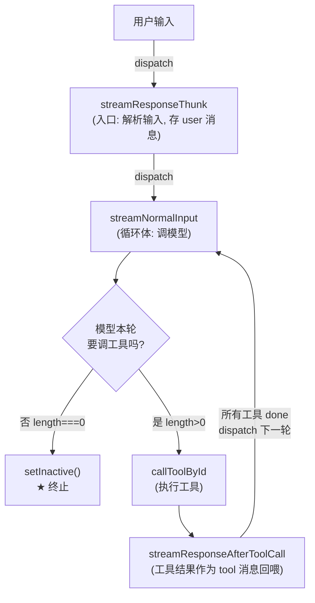
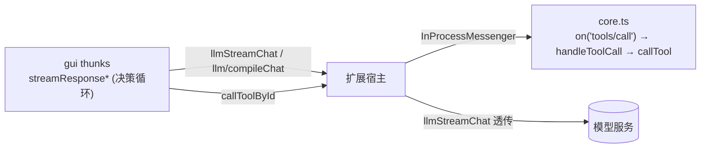
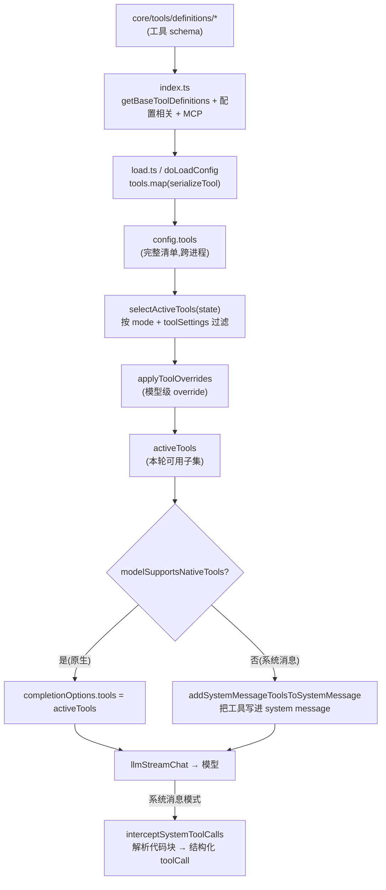

# Continue 的 Agent Harness 实现

> [!abstract] 一句话总结
> Continue 的 agent harness（循环调 LLM、执行工具、回喂结果直到完成）**不是 `while` 转圈，而是 Redux thunk 之间的递归 dispatch**。入口是 `streamResponseThunk`（处理用户输入），循环体是 `streamNormalInput`（调模型 + 决定是否调工具），工具执行后由 `streamResponseAfterToolCall` 把结果回喂并 dispatch 下一轮。**终止条件：某轮模型输出里不再包含工具调用。** 判断“任务是否完成”的智能在**模型**，代码只忠实执行“模型要调工具就调、不调就停”。

相关笔记：[[01-实现一个类Continue的带界面插件]]

---

## 1. 整体结构：递归式循环，不是 while



> [!important] 关键认知
>
> - 循环的“下一轮”靠 `streamResponseAfterToolCall → streamNormalInput` 的**再次 dispatch**形成，不是 `while(true)`。
> - `streamNormalInput` 内部确实有一个 `while(!next.done)`，但那只是**消费模型流式 token**（逐字显示到界面），**不是** agent 循环。
> - 每递归一层 `depth + 1`，用于调试 / 观测循环深度。

---

## 2. 文件与职责对应表

| 环节                        | 文件                                                  | 关键符号                                                  | 职责                                           |
| --------------------------- | ----------------------------------------------------- | --------------------------------------------------------- | ---------------------------------------------- |
| **入口（用户发消息）**      | `gui/src/pages/gui/Chat.tsx`                          | `dispatch(streamResponseThunk(...))`                      | 用户输入框回车触发（主入口）                   |
| 入口（出错重试）            | `gui/src/pages/gui/StreamError.tsx`                   | `dispatch(streamResponseThunk(...))`                      | 报错后“重试”按钮                               |
| 入口（MCP 应用触发）        | `gui/src/pages/gui/ToolCallDiv/MCPAppRenderer.tsx`    | `dispatch(streamResponseThunk(...))`                      | MCP 交互程序化发起                             |
| **输入处理 + 启动**         | `gui/src/redux/thunks/streamResponse.ts`              | `streamResponseThunk`                                     | 解析编辑器内容 → 存 user 消息 → 启动循环       |
| **循环体（调模型/判工具）** | `gui/src/redux/thunks/streamNormalInput.ts`           | `streamNormalInput`                                       | 流式调模型、收集工具调用、策略检查、执行或终止 |
| **工具后回环**              | `gui/src/redux/thunks/streamResponseAfterToolCall.ts` | `streamResponseAfterToolCall`、`areAllToolsDoneStreaming` | 工具结果回喂 → 再 dispatch 循环体              |
| 工具执行                    | `gui/src/redux/thunks/callToolById.ts`                | `callToolById`                                            | 执行单个工具（可能转到 Core）                  |
| 对话状态                    | `gui/src/redux/slices/sessionSlice.ts`                | `streamUpdate`、`updateHistoryItemAtIndex`                | 维护对话历史（user / assistant / tool 消息）   |
| 调模型（跨层）              | `gui/src/context/IdeMessenger.tsx`                    | `llmStreamChat`、`request("llm/compileChat")`             | 把调模型的活发给扩展 → Core                    |
| 工具执行（Core 侧）         | `core/core.ts`                                        | `on("tools/call")` → `handleToolCall` → `callTool`        | Core 侧真正执行工具                            |

---

## 3. 入口：接收用户输入 `streamResponseThunk`

文件：`gui/src/redux/thunks/streamResponse.ts`

被 `Chat.tsx` 在用户发送消息时调用：

```ts
// gui/src/pages/gui/Chat.tsx
void dispatch(streamResponseThunk({ editorState, modifiers, index }));
```

thunk 本身做三件事：**解析输入 → 存 user 消息 → 启动循环**（不直接调模型）。

```ts
// streamResponse.ts
export const streamResponseThunk = createAsyncThunk(
  "chat/streamResponse",
  async ({ editorState, modifiers, index }, { dispatch, extra, getState }) => {
    // ① 把富文本框内容解析成「消息内容 + 上下文 + 选中代码」
    const { selectedContextItems, selectedCode, content } =
      await resolveEditorContent({ editorState, modifiers, ideMessenger: extra.ideMessenger, ... });

    // ② 把用户消息写入对话历史
    dispatch(updateHistoryItemAtIndex({
      index: inputIndex,
      updates: { message: { role: "user", content, id: uuidv4() }, contextItems: selectedContextItems },
    }));

    // ③ 启动循环第一轮
    unwrapResult(await dispatch(streamNormalInput({ legacySlashCommandData: ... })));
  },
);
```

---

## 4. 循环体：`streamNormalInput`

文件：`gui/src/redux/thunks/streamNormalInput.ts`

一轮做四步：**调模型 → 收工具调用 → 策略检查 → 执行或终止**。

### 4.1 调模型 + 流式消费 token

```ts
// 编译上下文（可能裁剪）
const precompiledRes = await extra.ideMessenger.request("llm/compileChat", { messages, options: completionOptions });
const { compiledChatMessages } = precompiledRes.content;

// 流式调模型
let gen = extra.ideMessenger.llmStreamChat({ messages: compiledChatMessages, ... }, streamAborter.signal);

let next = await gen.next();
while (!next.done) {                    // ← 只是消费流式 token，不是 agent 循环
  if (!getState().session.isStreaming) {
    dispatch(abortStream());            // 用户中止
    break;
  }
  dispatch(streamUpdate(next.value));   // 实时更新界面（逐字显示）
  next = await gen.next();
}
```

### 4.2 收集 + 预处理 + 策略检查

```ts
// 把本轮模型要求调用的工具标记为已生成
const generatingCalls = originalToolCalls.filter(
  (tc) => tc.status === "generating",
);
for (const { toolCallId } of generatingCalls)
  dispatch(setToolGenerated({ toolCallId, tools }));

await preprocessToolCalls(dispatch, extra.ideMessenger, generatedCalls2); // 校验参数
const policies = await evaluateToolPolicies(
  dispatch,
  extra.ideMessenger,
  activeTools,
  generatedCalls3,
  toolPolicies,
); // 安全策略
const autoApprovedPolicies = policies.filter(
  (p) => p.policy === "allowedWithoutPermission",
); // 免批准
const needsApprovalPolicies = policies.filter(
  (p) => p.policy === "allowedWithPermission",
); // 需用户批准
```

### 4.3 执行工具 / 或终止（★ 决策点）

```ts
if (originalToolCalls.length === 0) {
  dispatch(setInactive()); // ★ 模型没要调工具 → 终止（任务完成）
} else if (needsApprovalPolicies.length > 0) {
  // 先执行只读且自动批准的，其余等用户点“允许”
  await Promise.all(
    builtInReadonlyAutoApproved.map(({ toolCallState }) =>
      dispatch(
        callToolById({
          toolCallId: toolCallState.toolCallId,
          isAutoApproved: true,
          depth: depth + 1,
        }),
      ),
    ),
  );
  dispatch(setInactive()); // 暂停，等待用户批准
} else {
  // 全部可自动执行
  if (generatedCalls4.length > 0) {
    await Promise.all(
      generatedCalls4.map(({ toolCallId }) =>
        dispatch(
          callToolById({ toolCallId, isAutoApproved: true, depth: depth + 1 }),
        ),
      ),
    );
  } else {
    for (const { toolCallId } of originalToolCalls) {
      dispatch(streamResponseAfterToolCall({ toolCallId, depth: depth + 1 }));
    }
  }
}
```

---

## 5. 回环：`streamResponseAfterToolCall`

文件：`gui/src/redux/thunks/streamResponseAfterToolCall.ts`

工具执行完后触发，**把工具输出作为 `role:"tool"` 消息塞回对话，确认所有工具完成后再 dispatch 循环体**，形成“下一轮”。

```ts
export const streamResponseAfterToolCall = createAsyncThunk(
  "chat/streamAfterToolCall",
  async ({ toolCallId, depth = 0 }, { dispatch, getState }) => {
    const toolCallState = selectCurrentToolCalls(getState()).find(
      (tc) => tc.toolCallId === toolCallId,
    );
    if (!toolCallState) return;

    // ① 工具输出 → role:"tool" 消息，加入对话历史
    const newMessage: ChatMessage = {
      role: "tool",
      content: renderContextItems(toolCallState.output ?? []),
      toolCallId,
    };
    dispatch(streamUpdate([newMessage]));

    // ② 该 assistant 消息的所有工具都完成了吗？
    const assistantMessage = getState().session.history.findLast(
      (item) =>
        item.message.role === "assistant" &&
        item.toolCallStates?.some((tc) => tc.toolCallId === toolCallId),
    );

    // ③ 都完成 → 再调一次模型（= 回到循环体）
    if (
      assistantMessage &&
      areAllToolsDoneStreaming(
        assistantMessage,
        state.config.config.ui?.continueAfterToolRejection,
      )
    ) {
      unwrapResult(await dispatch(streamNormalInput({ depth: depth + 1 })));
    }
  },
);
```

“所有工具完成”的判断：

```ts
function areAllToolsDoneStreaming(
  assistantMessage,
  continueAfterToolRejection,
): boolean {
  if (!assistantMessage.toolCallStates) return true;
  const completed = assistantMessage.toolCallStates.filter(
    (tc) =>
      tc.status === "done" ||
      tc.status === "errored" ||
      (continueAfterToolRejection && tc.status === "canceled"),
  );
  return completed.length === assistantMessage.toolCallStates.length;
}
```

---

## 6. 如何终止

> [!important] 主终止条件
> 在 `streamNormalInput` 第 4.3 步：**`if (originalToolCalls.length === 0)` → `setInactive()`**。
> 即“本轮模型输出里没有工具调用”就终止——而**是否再调工具由模型决定**：它看着含历史工具结果的完整对话，自己选择“再调个工具”还是“给出最终文字答复（=完成）”。

全部停止 / 暂停情形：

| 情况                   | 结果             | 触发者      | 代码位置                                              |
| ---------------------- | ---------------- | ----------- | ----------------------------------------------------- |
| 模型本轮**无工具调用** | 终止（任务完成） | **模型**    | `streamNormalInput` `length === 0`                    |
| 工具需用户批准         | 暂停，等批准     | 策略 + 用户 | `needsApprovalPolicies.length > 0`                    |
| 用户点“停止”           | 立即中止         | 用户        | `isStreaming` / `streamAborter.signal.aborted` 检查处 |
| 上下文超限 / 出错      | 终止报错         | 系统        | `precompiledRes.error.includes("Not enough context")` |
| 一轮内工具未全部完成   | 先不进下一轮     | 代码防护    | `areAllToolsDoneStreaming(...)`                       |

示例（“改成异步并跑测试”）：

```
轮1: 模型 → 调 editFile          (length>0, 继续)
轮2: 模型(见改好) → 调 runTests   (length>0, 继续)
轮3: 模型(见测试过) → "改好了✅"   (无工具调用, length=0 → 终止)
```

---

## 7. 跨层协作（harness 不只在 gui）

> [!note]
> gui 的 thunk 负责**决策循环**；真正“调模型”“执行工具”会经消息总线落到扩展 / Core。参见 [[01-实现一个类Continue的带界面插件#4-界面--扩展--core-的通信]]。



- 调模型：`extra.ideMessenger.llmStreamChat(...)` / `request("llm/compileChat")` → 扩展 → Core/模型。
- 执行工具：`callToolById` → （部分）Core `handleToolCall` → `callTool`，或扩展侧 Manager（如 `ApplyManager` 处理 `applyToFile`）。

---

## 8. 关键符号速查

| 符号                                         | 文件                                                  | 作用                                 |
| -------------------------------------------- | ----------------------------------------------------- | ------------------------------------ |
| `streamResponseThunk`                        | `gui/src/redux/thunks/streamResponse.ts`              | 入口：输入处理 + 启动循环            |
| `streamNormalInput`                          | `gui/src/redux/thunks/streamNormalInput.ts`           | 循环体：调模型 + 判工具 + 终止       |
| `streamResponseAfterToolCall`                | `gui/src/redux/thunks/streamResponseAfterToolCall.ts` | 回环：工具结果回喂 + dispatch 下一轮 |
| `areAllToolsDoneStreaming`                   | 同上                                                  | 判断本轮工具是否全部完成             |
| `callToolById`                               | `gui/src/redux/thunks/callToolById.ts`                | 执行单个工具                         |
| `handleToolCall` / `callTool`                | `core/core.ts` / `core/tools/callTool.ts`             | Core 侧工具执行                      |
| `llmStreamChat`                              | `gui/src/context/IdeMessenger.tsx`                    | 跨层流式调模型                       |
| `setInactive` / `setActive` / `streamUpdate` | `gui/src/redux/slices/sessionSlice.ts`                | 循环状态 + 对话历史更新              |

## 9. 相关主题

- [[01-实现一个类Continue的带界面插件]]
- [[VS Code Webview API]]
- [[Redux Thunk]]
- [[Agent Tool Calling]]

---

## 10. `callToolById`：从 gui 一路调到 Core `callTool`

> [!abstract] 一句话
> `callToolById`(gui thunk)负责**执行单个工具**。它有一个关键分流:**客户端工具**(在 gui/扩展侧跑,如 editFile)直接本地执行;**Core 工具**(如 readFile、runTerminalCommand)通过消息 `request("tools/call")` 发到 Core 的 `handleToolCall → callTool` 执行。执行完,再 dispatch `streamResponseAfterToolCall` 把结果回喂,回到主循环。

### 10.1 两类工具的分流（关键）

文件:`core/tools/builtIn.ts`

```ts
// CLIENT_TOOLS_IMPLS:只有这 3 个在"客户端(gui/扩展)"侧执行,不走 Core
// 它们都是"编辑文件类",要操作编辑器 diff,只能在贴 VS Code 的那层跑
export const CLIENT_TOOLS_IMPLS = [
  BuiltInToolNames.EditExistingFile, // edit_existing_file
  BuiltInToolNames.SingleFindAndReplace, // single_find_and_replace
  BuiltInToolNames.MultiEdit, // multi_edit
];
```

> [!warning] 别误解
> `CLIENT_TOOLS_IMPLS` **不是"全部工具"**,只是从全部工具里挑出“在客户端执行”的 3 个。全部内置工具名在同文件的 `BuiltInToolNames` 枚举(约 20 个);其余(readFile/runTerminalCommand/grep/ls...)都在 **Core** 执行。`callToolById` 用 `CLIENT_TOOLS_IMPLS.includes(name)` 做分流。

`callToolById`(`gui/src/redux/thunks/callToolById.ts`)里据此分流:

```ts
// 伪结构
if (CLIENT_TOOLS_IMPLS.includes(toolName)) {
  // 客户端工具:在 gui/扩展侧直接执行(如 editFile → 走 ApplyManager / VerticalDiffManager)
  output = await callClientTool(toolCall, { ... });
} else {
  // Core 工具:发消息到 Core 执行
  const result = await extra.ideMessenger.request("tools/call", { toolCall });
  output = result.content.contextItems;
}
// 执行完,把输出写回 state,并触发回环
dispatch(setToolCallOutput({ toolCallId, output }));
await dispatch(streamResponseAfterToolCall({ toolCallId, depth }));
```

> [!note] 为什么分两类
>
> - **客户端工具**:需要操作编辑器 UI(如 `editFile` 要画 diff、`ApplyManager`),只能在贴着 VS Code 的那层跑。
> - **Core 工具**:纯逻辑/文件/系统操作(读文件、跑命令、搜索),放 Core 以便跨 IDE 复用。

### 10.2 Core 侧执行:`handleToolCall → callTool`

文件:`core/core.ts` → `core/tools/callTool.ts`

```ts
// core/core.ts:接收 gui 发来的 tools/call 消息
on("tools/call", async ({ data: { toolCall } }) => this.handleToolCall(toolCall));

private async handleToolCall(toolCall: ToolCall) {
  const { config } = await this.configHandler.loadConfig();
  const tool = config.tools.find(t => t.function.name === toolCall.function.name); // 按名字找工具
  const result = await callTool(tool, toolCall, { config, ide: this.ide, ... });   // 执行
}
```

`callTool`(`core/tools/callTool.ts`)按工具名分派到具体实现(impl):

```ts
// callTool 内部(简化):按 tool.function.name 分派
switch (name) {
  case BuiltInToolNames.ReadFile:
    return readFileImpl(args, extras);
  case BuiltInToolNames.RunTerminalCommand:
    return runTerminalCommandImpl(args, extras);
  case BuiltInToolNames.LSTool:
    return lsToolImpl(args, extras);
  // ...其余 impl
  // MCP 工具:mcp:// 开头 → 走 MCPManager
  // HTTP 工具:http(s):// → callHttpTool
}
```

> [!tip] 三种工具来源
> `callTool` 能处理三类:**内置工具**(impl 函数)、**MCP 工具**(`mcp://` → `MCPManagerSingleton`)、**HTTP 工具**(远程 URL → `callHttpTool`)。

---

## 11. “有哪些工具可调用” —— 在哪设置

> [!important] 工具清单的来源
> 工具定义(给模型看的 schema)集中在 **`core/tools/definitions/`**,由 **`core/tools/index.ts`** 组装成清单,最终进入 `config.tools`。模型每轮看到的“可用工具”就是这个清单。

### 11.1 工具清单组装:`core/tools/index.ts`

```ts
// 基础工具(总是可用)
export const getBaseToolDefinitions = () => [
  toolDefinitions.readFileTool,
  toolDefinitions.createNewFileTool,
  toolDefinitions.runTerminalCommandTool,
  toolDefinitions.globSearchTool,
  toolDefinitions.viewDiffTool,
  toolDefinitions.readCurrentlyOpenFileTool,
  toolDefinitions.lsTool,
  toolDefinitions.createRuleBlock,
  toolDefinitions.fetchUrlContentTool,
];

// 依赖配置的工具(按模型/实验开关/是否远程 动态增减)
export const getConfigDependentToolDefinitions = async (params) => {
  const tools = [];
  tools.push(
    await toolDefinitions.requestRuleTool(params),
    await toolDefinitions.readSkillTool(params),
  );
  tools.push(toolDefinitions.searchWebTool);
  if (params.enableExperimentalTools)
    tools.push(
      viewRepoMapTool,
      viewSubdirectoryTool,
      codebaseTool,
      readFileRangeTool,
    );
  if (isRecommendedAgentModel(params.modelName))
    tools.push(multiEditTool); // 强模型用 multiEdit
  else tools.push(editFileTool, singleFindAndReplaceTool); // 其他用 editFile
  if (!params.isRemote) tools.push(grepSearchTool);
  return tools;
};
```

要点:

- **基础工具**恒定可用;**配置相关工具**按模型能力、实验开关(`enableExperimentalTools`)、是否远程环境动态启用。
- 还有 **MCP 工具** 会被合并进来(来自用户配的 MCP 服务器)。
- 最终合成 `config.tools`,`handleToolCall` 用 `config.tools.find(...)` 按名字查工具。

### 11.2 单个工具定义长什么样(以 readFile 为例)

文件:`core/tools/definitions/readFile.ts`

```ts
export const readFileTool: Tool = {
  type: "function",
  displayTitle: "Read File",
  readonly: true,          // 只读 → 影响自动批准策略
  isInstant: true,
  group: BUILT_IN_GROUP_NAME,
  function: {
    name: BuiltInToolNames.ReadFile,          // 工具名(模型调用时用)
    description: "Use this tool if you need to view the contents of an existing file.",
    parameters: {                             // 参数 schema(模型按此填参)
      type: "object", required: ["filepath"],
      properties: { filepath: { type: "string", description: "..." } },
    },
  },
  systemMessageDescription: { ... },          // 注入系统消息,教模型怎么用
  defaultToolPolicy: "allowedWithoutPermission", // 默认免批准(只读安全)
  preprocessArgs: async (args, { ide }) => ({ resolvedPath: await resolveInputPath(ide, args.filepath) }),
  evaluateToolCallPolicy: (basePolicy, _, processedArgs) => {  // 动态策略:工作区内外不同
    return evaluateFileAccessPolicy(basePolicy, processedArgs.resolvedPath.isWithinWorkspace);
  },
};
```

> [!note] 一个工具定义包含
>
> - `function.name / description / parameters`:**给模型看的**(决定模型能调它、怎么填参)
> - `readonly / defaultToolPolicy / evaluateToolCallPolicy`:**安全策略**(能否自动执行)
> - `preprocessArgs`:执行前预处理参数
> - 真正的**执行逻辑不在定义里**,在 `core/tools/implementations/*Impl`

### 11.3 工具如何给到 LLM

> [!important] 从 `config.tools` 到模型请求
> 工具定义清单在**配置加载时**落到 `config.tools`,但模型每一轮**实际看到的**不是整份清单:要先按模式/策略**筛选**出 `activeTools`,再决定用哪种方式**喂给模型**(原生 function-calling 还是系统消息)。

**三级链路概述:**

1. **① 配置加载 → `config.tools`**
   `doLoadConfig` / `core/config/load.ts` 调 `getBaseToolDefinitions()` + 配置相关工具 + MCP 工具合成清单,最后 `tools: final.tools.map(serializeTool)` 写进 `config.tools`。
   - `serializeTool` 会**剥掉函数字段**(`preprocessArgs`、`evaluateToolCallPolicy`),只保留可序列化的 schema/策略,因为这份清单要跨进程(Core ↔ GUI)传递。
2. **② 每轮 `streamNormalInput` → `activeTools`**
   `selectActiveTools(state)` 从 `config.tools` 里按**当前模式**(`chat` 返回空、`plan` 只留只读/非内置)和**工具策略**(`toolSettings` / `toolGroupSettings`,`disabled` / `exclude` 过滤)选出子集;若模型配了 `toolOverrides`,再 `applyToolOverrides` 改描述/禁用。
3. **③ 放进 `completionOptions.tools` → `llmStreamChat`**
   原生工具模式下 `completionOptions = { tools: activeTools }`,随 `ideMessenger.llmStreamChat({ completionOptions, messages, ... })` 发给模型。



**两种“给模型”方式对比:**

判断依据是 `modelSupportsNativeTools(selectedChatModel)`(可被 `experimental.onlyUseSystemMessageTools` 强制关掉)。

| 维度             | 原生 function-calling                                      | 系统消息工具                                                          |
| ---------------- | ---------------------------------------------------------- | --------------------------------------------------------------------- |
| 触发条件         | `modelSupportsNativeTools` 为 `true`                       | 为 `false`(或实验开关强制)                                            |
| 工具怎么到模型   | 塞进 `completionOptions.tools`,走 provider 原生 tools 字段 | `addSystemMessageToolsToSystemMessage` 把工具描述拼进 system message  |
| 模型如何表达调用 | provider 返回结构化 tool_call                              | 模型在正文里按约定格式输出代码块                                      |
| 解析调用         | provider/适配层直接给结构化结果                            | `interceptSystemToolCalls` 包在流外层,把代码块解析成结构化 `toolCall` |
| 框架             | 无额外框架                                                 | `SystemMessageToolCodeblocksFramework`                                |

> [!note] 两条路最后汇到同一处
> 不论原生还是系统消息,解析出的都是统一的结构化工具调用,后续才进入 §12 的「策略评估 → 执行 → 回填结果」流程。区别只在**工具怎么描述给模型**、**模型的调用怎么被解析出来**。

---

## 12. 具体工具完整调用链

### 12.1 `readFile`（Core 工具,只读)

```
模型输出 "调用 read_file, filepath=src/foo.ts"
  │ streamNormalInput 收集到工具调用
  │ 策略: readonly + defaultToolPolicy=allowedWithoutPermission → 自动批准
  ▼
callToolById(toolCallId)                         (gui thunk)
  │ read_file 不在 CLIENT_TOOLS_IMPLS → Core 工具
  │ extra.ideMessenger.request("tools/call", { toolCall })   跨进程 → 扩展 → Core
  ▼
core.ts  on("tools/call") → handleToolCall(toolCall)
  │ config.tools.find(name==="read_file")
  │ callTool(tool, toolCall, extras)
  ▼
callTool → readFileImpl(args, extras)            (core/tools/implementations/readFile.ts)
  │ 内部调 extras.ide.readFile(filepath)  ← 经 MessageIde → 扩展 VsCodeIde 真正读文件
  ▼
返回 ContextItem[](文件内容) → 原路回到 gui
  ▼
dispatch(setToolCallOutput) + streamResponseAfterToolCall → 回喂 role:"tool" 消息 → 下一轮
```

### 12.2 `runTerminalCommand`（Core 工具,通常需批准)

```
模型输出 "调用 run_terminal_command, command=npm test"
  │ streamNormalInput 收集 + 策略评估
  │ 跑命令有风险 → 多为 allowedWithPermission → 弹窗等用户点"允许"
  ▼
(用户批准后) callToolById(toolCallId)
  │ Core 工具 → request("tools/call", { toolCall })
  ▼
core.ts handleToolCall → callTool → runTerminalCommandImpl(args, extras)
  │ 经 extras.ide / 子进程机制执行命令,流式输出
  │ 过程中 send("toolCallPartialOutput", ...) 把实时输出推给界面
  ▼
命令结束 → 返回输出 ContextItem[] → 回 gui
  ▼
streamResponseAfterToolCall → role:"tool" 消息(命令输出)→ 下一轮(模型看结果决定下一步)
```

> [!tip] 对比两者
>
> - `readFile`:只读、`allowedWithoutPermission`、`isInstant` → **自动跑**,无需用户点。
> - `runTerminalCommand`:有副作用 → 多数策略下**需用户批准**,且支持流式输出(`toolCallPartialOutput`)。

### 12.3 客户端工具对比:`editFile`

```
模型调 editFile
  │ editFile ∈ CLIENT_TOOLS_IMPLS → 不走 Core
  ▼
callToolById 直接在 gui/扩展侧执行 → 触发 applyToFile → ApplyManager + VerticalDiffManager
  │ (见 [[01-实现一个类Continue的带界面插件]] 的 diff 流程)
  ▼
画绿红 diff、用户 Accept/Reject → 结果回喂 → 下一轮
```
