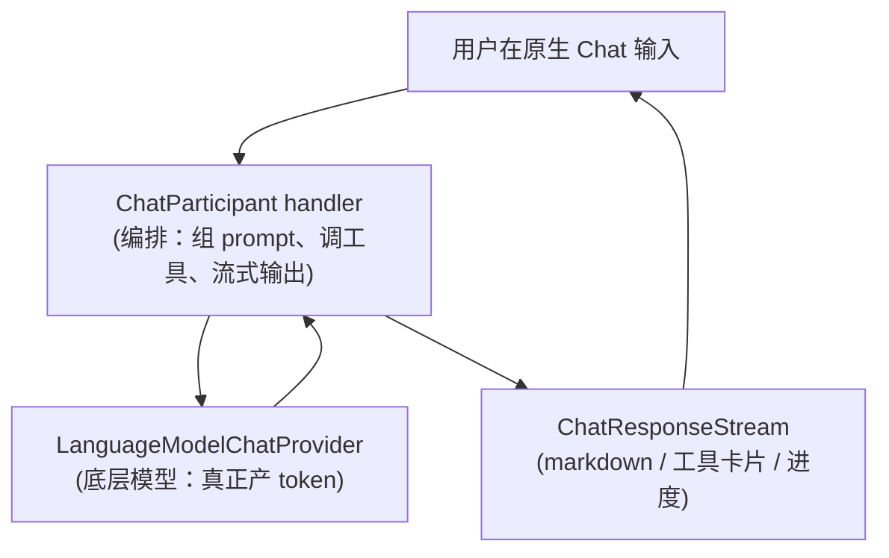

# VS Code Chat Participant API

> [!abstract] 一句话
> 这套 API 让你**不用自己写界面**，直接把自己的 AI 接进 VS Code 内置的原生 Chat 面板（和 Copilot 共用那个 UI）。核心是两组接口：**Chat Participant**（谁来回答）和 **Language Model Provider**（底层模型）。

> [!warning] API 稳定性
> 其中部分能力属于 **proposed API**，需要在 `package.json` 的 `enabledApiProposals` 声明，且只能在特定 VS Code 版本/Insiders 下用。生产前确认目标版本是否已稳定。

---

## 1. 两组接口的分工



| 接口                                   | 回答「什么」                   | 关键方法                               |
| -------------------------------------- | ------------------------------ | -------------------------------------- |
| `chat.createChatParticipant`           | 谁来接管一次对话、怎么编排回答 | handler(request, ctx, response, token) |
| `lm.registerLanguageModelChatProvider` | 底层用哪个模型、怎么产 token   | `provideLanguageModelChatResponse` 等  |

> [!note]
> 两者可独立使用：只注册 Participant（复用别人家的模型）、或只注册 Provider（让自己的模型出现在模型下拉里）。Continue 这个 fork **两个都注册了**。

---

## 2. Chat Participant

### 2.1 package.json 声明

```jsonc
"contributes": {
  "chatParticipants": [{
    "id": "micatcode.chat",
    "name": "MicatCode",
    "fullName": "MicatCode AI",
    "isDefault": true,
    "locations": ["panel"],
    "modes": ["ask", "agent", "edit"]
  }]
}
```

### 2.2 实现 handler

```ts
const participant = vscode.chat.createChatParticipant(
  "micatcode.chat",
  async (request, chatContext, response, token) => {
    // request.prompt     用户输入
    // response            输出流
    // token               取消信号
    response.markdown("正在思考…");
    // 调你的逻辑/模型，流式写回
  },
);
participant.isSticky = false;
context.subscriptions.push(participant);
```

### 2.3 `ChatResponseStream` 能输出什么

| 方法 / 部件                                      | 效果                               |
| ------------------------------------------------ | ---------------------------------- |
| `response.markdown(text)`                        | 普通富文本回答                     |
| `response.thinkingProgress({id,text})`           | 「思考中」进度                     |
| `response.push(new ChatToolInvocationPart(...))` | 工具调用卡片（展示入参/出参/状态） |

> [!tip] Continue 的事件映射
> `registerLanguageModelProvider.ts` 的 `streamNativeAgentChat` 把 Core 的 agent 事件逐个翻成这些部件：
>
> ```ts
> case "text":       response.markdown(event.text); break;
> case "thinking":   response.thinkingProgress({ id, text: event.text }); break;
> case "tool-start": response.push(new vscode.ChatToolInvocationPart(/* ... */)); break;
> case "tool-complete": /* 填 input/output，isComplete=true */ break;
> ```

---

## 3. Language Model Provider

### 3.1 package.json 声明

```jsonc
"contributes": {
  "languageModelChatProviders": [
    { "vendor": "micatcode", "displayName": "MicatCode AI" }
  ]
},
"enabledApiProposals": ["chatProvider", "defaultChatParticipant", "chatParticipantAdditions"]
```

### 3.2 实现 Provider

```ts
class MicatLanguageModelProvider {
  // 1) 声明你的模型有哪些、能力如何
  provideLanguageModelChatInformation() {
    return [
      {
        id: "micatcode.continue.chat",
        name: "MicatCode AI",
        family: "micatcode",
        maxInputTokens: 128000,
        maxOutputTokens: 8192,
        capabilities: { toolCalling: false },
        isDefault: true,
      },
    ];
  }

  // 2) 流式产出回答
  async provideLanguageModelChatResponse(
    model,
    messages,
    options,
    progress,
    token,
  ) {
    // 把 VS Code 的消息转成自家格式 → 调模型 → 逐段 report
    progress.report(new vscode.LanguageModelTextPart("部分回答…"));
  }

  // 3) 估算 token 数
  async provideTokenCount(model, value) {
    return Math.ceil(len(value) / 4);
  }
}

vscode.lm.registerLanguageModelChatProvider(
  "micatcode",
  new MicatLanguageModelProvider(runtime),
);
```

### 3.3 消息格式转换

VS Code 的消息角色是枚举/对象，需要转成模型侧的 `{role, content}`：

```ts
const role =
  m.role === vscode.LanguageModelChatMessageRole.User
    ? "user"
    : m.role === "system"
      ? "system"
      : "assistant";
```

> Continue 的 `toContinueMessages()` 做了这层归一化，并过滤空消息。

---

## 4. 取消与错误

- **取消**：handler 收到 `token: CancellationToken`，监听 `onCancellationRequested` 调用自家的 abort；并在循环里查 `token.isCancellationRequested` 提前 break。
  ```ts
  const sub = token.onCancellationRequested(() =>
    continueExtension.abortNativeChat(requestId),
  );
  try {
    /* for await ... if (token.isCancellationRequested) break; */
  } finally {
    sub.dispose();
  }
  ```
- **错误脱敏**：把 bearer / api-key / `sk-...` 等敏感串替换成 `[REDACTED]` 再展示（Continue 的 `userSafeError`）。

> [!warning] 不要泄漏密钥
> 回答流里可能包含请求细节，务必在展示前做脱敏。

---

## 5. 自建 Webview vs 原生 Chat（怎么选）

| 维度        | 自建 Webview（[[VS Code Webview API]]） | 原生 Chat Participant           |
| ----------- | --------------------------------------- | ------------------------------- |
| UI 自由度   | 完全自定义                              | 受限于 VS Code 规定的部件       |
| 开发量      | 大（要写整套前端）                      | 小（复用内置面板）              |
| 跨 IDE 一致 | 好                                      | 仅 VS Code                      |
| API 稳定性  | 稳定                                    | 部分 proposed                   |
| 适合        | 想要品牌化/复杂交互                     | 想快速接入、与 Copilot 面板统一 |

> [!note] 一个 Core，两条前端
> Continue 两条都接，但都收口到同一个 Core：`streamNativeChat` → `inProcessMessenger.invoke("llm/streamChat", ...)`。前端只是「壳」，逻辑不重复。详见 [[Continue 如何实现 VS Code 的钩子与接口#7 可选接口：接入 VS Code 原生 Chat]]。

## 相关笔记

- [[实现一个类 Continue 的带界面 VS Code 插件]]
- [[Continue 如何实现 VS Code 的钩子与接口]]
- [[VS Code Webview API]]
