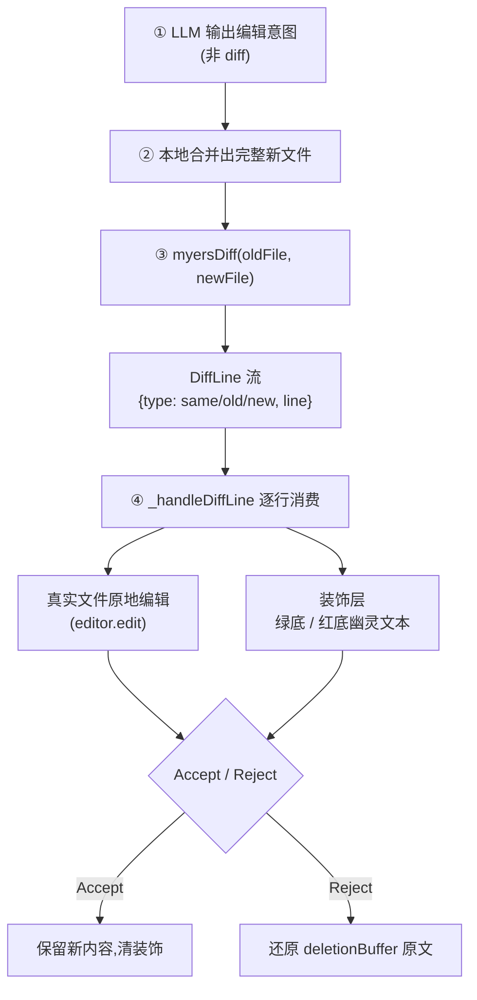

# ✏️ Continue 的 Diff 生成与渲染

> [!abstract] 这是什么
> 拆解 Continue「编辑文件」从**模型产出**到**编辑器里绿/红高亮**的完整链路。核心结论:**大模型不产出 diff**,它只产出「编辑意图」;diff(`DiffLine` 流)由本地算法算出;渲染是**原地改真实文件 + 装饰层**,不写缓存文件、不开分栏视图。

---

## 1. 全链路总图

> [!important] 四个阶段,各司其职
> ① 模型产出**编辑意图** → ② 本地合并出**完整新文件** → ③ 本地 `myersDiff` 算出 **DiffLine 流** → ④ VS Code 把流当编辑指令**原地改文件 + 加装饰**。



---

## 2. 阶段 ①:模型产出的是「编辑意图」,不是 diff

> [!warning] 常见误解
> 大模型**不会**产出 `+`/`-`、行号、`@@` 这种 diff,也**不会**直接产出 `DiffLine`。它随工具不同产出两种「意图」。

### 2.1 `edit_existing_file`:懒惰新内容

文件:`core/tools/definitions/editFile.ts`。`changes` 参数要求「只写要改的部分,大段不变用 `// ... existing code ...` 占位,且不要包代码块」。

```json
{
  "name": "edit_existing_file",
  "arguments": {
    "filepath": "math.ts",
    "changes": "// ... existing code ...\n  return a - b\n// ... existing code ..."
  }
}
```

### 2.2 `multi_edit` / `single_find_and_replace`:查找替换对

文件:`core/tools/definitions/multiEdit.ts`。模型产出精确的 `old_string → new_string` 对,要求 `old_string` 逐字符(含空白/缩进)匹配原文。

```json
{
  "name": "multi_edit",
  "arguments": {
    "filepath": "math.ts",
    "edits": [
      { "old_string": "  return a + b", "new_string": "  return a - b" }
    ]
  }
}
```

> [!note] 为什么不让模型直接产 diff
> 模型手写 diff 的**行号/上下文极易对不上**,`git apply` 这类对行号敏感的操作会频繁失败。于是分工:模型表达「想要什么内容」,本地确定性算法负责「精确算 diff」。

---

## 3. 阶段 ②:本地合并出完整新文件

两种工具合并方式不同,但都是**纯内存计算,不写磁盘、不备份文件**。

### 3.1 editFile → `applyCodeBlock`

文件:`core/edit/lazy/applyCodeBlock.ts`。按优先级决定怎么把「懒惰片段」变成完整文件:

1. **确定性合并(instant apply)**:`canUseInstantApply` 看扩展名是否被 tree-sitter 支持,支持就走 `deterministicApplyLazyEdit`,用语法结构拼回完整文件,**不经过模型**。
2. **unified diff 兜底**:若模型碰巧吐了 unified diff,`isUnifiedDiffFormat` 命中就用 `applyUnifiedDiff` 套用。
3. **再请 apply 模型**:都不行则 `streamLazyApply` 用专门的 apply 模型(如 Relace instant-apply,见 `isFastApplyModel`)合成。

### 3.2 multiEdit → `executeMultiFindAndReplace`

文件:`core/edit/searchAndReplace/performReplace.ts`。它是**纯函数**:

```ts
export function executeMultiFindAndReplace(fileContent: string, edits) {
  let result = fileContent;                 // 原文本是字符串,不是文件句柄
  for (const edit of edits) {
    result = executeFindAndReplace(result, edit.old_string, edit.new_string, ...);
  }
  return result;                            // 返回新文本,原字符串不可变、未被改
}
```

在 `multiEdit.ts` 的 `preprocessArgs` 里,原内容和新内容两份都被带出来:

```ts
const editingFileContents = await extras.ide.readFile(fileUri); // 原内容
const newFileContents = executeMultiFindAndReplace(editingFileContents, edits); // 新内容
return { ...args, fileUri, editingFileContents, newFileContents };
```

> [!tip] 无需备份原文件
> 替换是纯字符串计算(`substring + newString + substring`),不落盘。原内容以**内存变量** `editingFileContents` 保留,足够后续还原。真正改文件在阶段 ④,其「撤销」靠内存 `deletionBuffer` + 编辑器 undo + git,而非 Continue 自己复制一份备份文件。

---

## 4. 阶段 ③:本地算出 DiffLine 流

文件:`core/diff/myers.ts`(底层用 npm `diff` 包的 `diffLines`,与 git 的 Myers 同源)。

### 4.1 DiffLine 结构

```ts
// core/index.d.ts
export type DiffType = "new" | "old" | "same";
export interface DiffLine {
  type: DiffType;
  line: string;
}
```

| type   | 含义                              | 判定                 |
| ------ | --------------------------------- | -------------------- |
| `same` | 新旧都存在、内容相同 → **未改动** | `!added && !removed` |
| `old`  | 只在旧文件 → **被删除**           | `change.removed`     |
| `new`  | 只在新文件 → **新增**             | `change.added`       |

### 4.2 两个要点

> [!note] 未改动行也在流里,但 type 是 `same`(绝不是 `old`)
> 流**按文件从上到下顺序**产出,且**包含全部 `same` 行**(这正是与 git diff 的核心差异:git 省略未改动行,Continue 保留)。编辑器端靠 `same` 行推进游标、对齐位置。`old` 严格只代表「删除」。

一行「内容改了」通常被拆成一对 `old` + `new`。但 `myers.ts` 有个特殊处理:若 `old`/`new` 两行 **trim 后相同**(只差缩进),会合并回 `same`:

```ts
if (
  ourFormat[i]?.type === "old" &&
  ourFormat[i + 1]?.type === "new" &&
  ourFormat[i].line.trim() === ourFormat[i + 1].line.trim()
) {
  ourFormat[i] = { type: "same", line: ourFormat[i].line }; // 退化成 same
  ourFormat.splice(i + 1, 1);
}
```

### 4.3 Demo:DiffLine 流

把 `return a + b` 改成 `return a - b`,产出:

```
{ type: "same", line: "function add(a, b) {" }
{ type: "old",  line: "  return a + b" }
{ type: "new",  line: "  return a - b" }
{ type: "same", line: "}" }
```

---

## 5. 阶段 ④:渲染 —— 原地改真实文件 + 装饰层

> [!important] 不写缓存文件,不开分栏 diff 视图
> Continue 直接改**你当前打开的那个文件缓冲区**(`editor.document`),再用 decoration 把新增标绿、把删除用「幽灵文本」标红。

### 5.1 逐行消费:`_handleDiffLine`

文件:`extensions/vscode/src/diff/vertical/handler.ts`。靠 `currentLineIndex` 游标顺序推进:

```ts
private async _handleDiffLine(diffLine: DiffLine) {
  switch (diffLine.type) {
    case "same":  // 不改内容,游标下移;顺便 flush 删除缓冲
      await this.insertDeletionBuffer();
      this.incrementCurrentLineIndex();
      break;
    case "old":   // 真删除当前行,原文进 deletionBuffer(稍后画红色幽灵行)
      this.deletionBuffer.push(diffLine.line);
      await this.deleteLinesAt(this.currentLineIndex);
      break;
    case "new":   // 真插入文本,并给这一行加绿色装饰
      await this.insertLineAboveIndex(this.currentLineIndex, diffLine.line);
      this.incrementCurrentLineIndex();
      break;
  }
}
```

### 5.2 装饰与颜色

文件:`extensions/vscode/src/diff/vertical/decorations.ts`。用 VS Code 主题里 diff 编辑器的标准配色:

```ts
// 新增行:整行绿底(真实内容)
addedLineDecorationType = { backgroundColor: { id: "diffEditor.insertedLineBackground" }, ... };

// 删除行:整行红底,原文作为灰色 after 幽灵文本显示(真实文本已被删)
removedLineDecorationType = (line) => ({
  backgroundColor: { id: "diffEditor.removedLineBackground" },
  after: { contentText: line, color: "#808080" },
});
```

> [!warning] new 与 old 在真实文件里的状态完全不同
>
> - **new(新增)**:**真的写进文件**,是真实内容,只是加了绿色背景。读文件内容读得到,保存会落盘。
> - **old(删除)**:**真的从文件删掉了**,文件里不存在这行。你看到的旧内容是**幽灵文本**(`after.contentText`,灰字),属于覆盖在编辑器上的纯视觉层,不在 `getText()` 里、选不中、不落盘。

### 5.3 幽灵文本(ghost text)怎么理解

幽灵文本 = decoration 的 `after.contentText` 渲染的文字,**只用于删除行**。它像在真实文件这张「纸」上盖了一层透明贴纸:贴纸上印了被删的旧内容,但纸本身没有。删除行源码里还用 `display: none` 把用户在该空壳行敲入的字符藏掉,避免和幽灵文本重叠。

### 5.4 Demo:屏幕上看到的 vs 文件真实内容

把 `return a + b` 改成 `return a - b` 后——

**真实文件内容(`editor.document` 实际是):**

```ts
function add(a, b) {
  return a - b;
}
```

**屏幕画面(真实内容 + 装饰层):**

```
  function add(a, b) {        ← same:真实内容,无装饰
  return a + b                ← old:红底 + 灰色幽灵文本(文件里已没有这行)
  return a - b                ← new:绿底 + 真实内容(文件里真有这行)
  }                           ← same:真实内容
```

> [!note] 真实 VS Code 里没有 `+`/`-` 前缀
> 靠的是整行背景色(绿/红)+ 红行的灰色幽灵文本,并在改动块旁浮出 CodeLens 的 **Accept / Reject** 按钮(`VerticalDiffCodeLens`)。

---

## 6. Accept / Reject

| 操作       | 对 new 行         | 对 old 行                      | 结果           |
| ---------- | ----------------- | ------------------------------ | -------------- |
| **Accept** | 本就是真内容,保留 | 清掉幽灵文本和装饰             | 文件即最终新版 |
| **Reject** | 删掉绿行(真内容)  | 从 `deletionBuffer` 把原文写回 | 文件恢复原样   |

> [!tip] 还原不靠备份文件
> Reject 的还原依赖内存里的 `deletionBuffer`;此外编辑器自带 undo 栈、项目 git 都可回退。全程不存在 Continue 复制的磁盘备份副本。

---

## 7. 与 git diff 的区别(速查)

| 维度           | Continue DiffLine 流           | git diff                       |
| -------------- | ------------------------------ | ------------------------------ |
| 形态           | 结构化对象流 `{type, line}`    | 纯文本 unified diff            |
| 改动标记       | `type: new/old/same`           | `+` / `-` / 前导空格           |
| 含未改动行     | 含(`same` 全量)                | 只含 hunk 附近少量上下文       |
| 行号 / hunk 头 | 无                             | 有(`@@ -a,b +c,d @@`)          |
| 比较对象       | 编辑器旧内容 vs 合并出的新内容 | git 版本对象(blob/tree/commit) |
| 载体           | 当前文件原地改 + 装饰          | 分栏只读对比视图               |
| 用途           | 实时行内高亮 + 流式应用        | 版本审查 / 补丁 / `git apply`  |

> [!note] 算法同源,服务对象不同
> 两者底层都是 Myers 系行级 diff。区别全在**输出格式和消费方**:一个服务「编辑器内实时高亮与流式应用」,一个服务「版本管理与补丁交换」。DiffLine 流不能直接 `git apply`,git diff 也不用来驱动行内高亮。

---

## 🗂️ 关键源码位置

| 概念               | 路径                                                 |
| ------------------ | ---------------------------------------------------- |
| editFile 工具定义  | `core/tools/definitions/editFile.ts`                 |
| multiEdit 工具定义 | `core/tools/definitions/multiEdit.ts`                |
| 懒惰合并入口       | `core/edit/lazy/applyCodeBlock.ts`                   |
| 查找替换(纯函数)   | `core/edit/searchAndReplace/performReplace.ts`       |
| myers diff         | `core/diff/myers.ts`                                 |
| DiffLine 类型      | `core/index.d.ts`                                    |
| 逐行渲染 handler   | `extensions/vscode/src/diff/vertical/handler.ts`     |
| 绿/红装饰          | `extensions/vscode/src/diff/vertical/decorations.ts` |
| apply 管理         | `extensions/vscode/src/apply/ApplyManager.ts`        |

---

## 🔑 一句话总结

> [!summary]
> 模型只产出**编辑意图**(懒惰新内容 / 查找替换对);本地纯内存合并出**完整新文件**;`myersDiff` 比对旧/新得到**含全量 `same` 行的 DiffLine 流**;VS Code 把流当编辑指令**原地改真实文件**(`new` 真插入标绿、`old` 真删除用红底幽灵文本显示原文、`same` 不动),配 Accept/Reject。全程不产 git 式 diff、不写缓存/备份文件、不开分栏视图。

---

#vscode #continue #diff #edit
