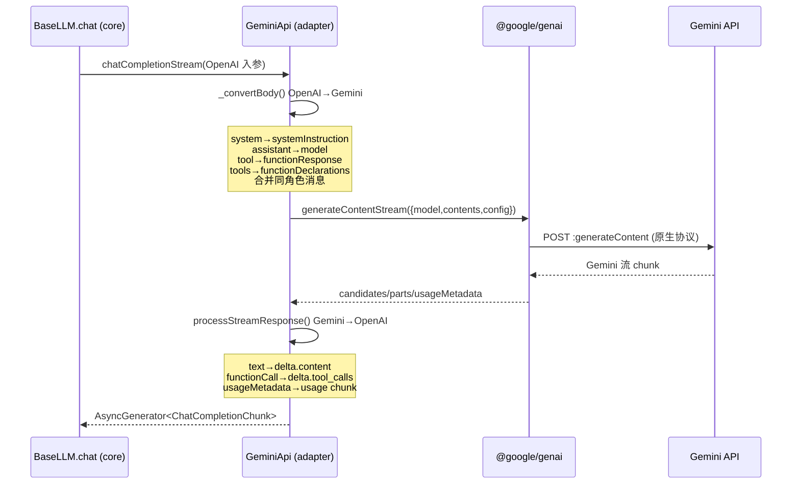

---
tags:
  - continue
  - llm
  - adapter
  - gemini
created: 2026-10-23
---

# 06 - Continue 的 openai-adapters 协议转换（以 Gemini 为例）

> [!abstract] 一句话
> `@continuedev/openai-adapters` 是一个**多协议网关包**：对上层统一暴露 OpenAI 风格接口（`BaseLlmApi`），对内按 provider 各自实现真实厂商协议。本文拆解它是**怎么把 OpenAI 风格请求转成 Gemini 的 `generateContent` 调用、再把 Gemini 响应转回 OpenAI 统一格式**的。

相关笔记：[[00-Continue整体架构总图]]、[[02-Continue的Agent-Harness实现]]

---

## 1. 它在整个调用链里的位置

```
BaseLLM.chat()                        core/llm/index.ts
   └─ shouldUseOpenAIAdapter("streamChat") ?
        ├─ 是 → openaiAdapter.chatCompletionStream()   ← 本文主角（统一网关）
        │         └─ constructLlmApi(provider) 分发到具体 Api 类
        │               ├─ OpenAIApi       (OpenAI 原生协议)
        │               ├─ AnthropicApi    (Anthropic /messages)
        │               └─ GeminiApi       (Gemini :generateContent)  ← 本文聚焦
        └─ 否 → this._streamChat()  provider 子类自己手写的老式 HTTP
```

- 关键判断字段：provider 子类里声明的 `useOpenAIAdapterFor` 数组（登记了哪个请求类型就走网关）。
- `Gemini.ts` 设了 `useOpenAIAdapterFor = ["chat", "embed", ...]`，所以走网关——**但网关内部走的是 Gemini 原生协议，不是 OpenAI 协议**。

> [!note] 核心认知
> "走 adapter" ≠ "遵循 OpenAI 协议"。adapter 是个翻译层：上层说 OpenAI 话，下层说各家方言。

---

## 2. 统一契约：`BaseLlmApi`

所有厂商 Api 类都实现同一个接口（`packages/openai-adapters/src/apis/base.ts`）。入参/出参全部复用 OpenAI 官方 SDK 的类型：

| 方法                      | 入参（OpenAI 类型）                      | 出参（OpenAI 类型）                   |
| ------------------------- | ---------------------------------------- | ------------------------------------- |
| `chatCompletionStream`    | `ChatCompletionCreateParamsStreaming`    | `AsyncGenerator<ChatCompletionChunk>` |
| `chatCompletionNonStream` | `ChatCompletionCreateParamsNonStreaming` | `Promise<ChatCompletion>`             |
| `embed`                   | `EmbeddingCreateParams`                  | `Promise<CreateEmbeddingResponse>`    |

因此"统一格式"= **OpenAI 的 `ChatCompletionChunk` / `ChatCompletion`**。每个厂商 Api 类的职责就是：入口把 OpenAI 入参翻成厂商请求，出口把厂商响应翻回 OpenAI 结构。

---

## 3. 请求方向：OpenAI → Gemini（`_convertBody`）

实现位于 `GeminiApi._convertBody()`（`apis/Gemini.ts`）。它把 OpenAI 的 `ChatCompletionCreateParams` 转成 Gemini `generateContent` 的请求体。

### 3.1 采样参数映射（命名差异）

| OpenAI 字段                  | Gemini `generationConfig` 字段      |
| ---------------------------- | ----------------------------------- |
| `top_p`                      | `topP`                              |
| `temperature`                | `temperature`                       |
| `max_tokens`                 | `maxOutputTokens`                   |
| `stop`（string 或 string[]） | `stopSequences`（过滤空串后的数组） |

### 3.2 消息结构映射（差异最大的部分）

OpenAI 的 `messages: [{role, content}]` → Gemini 的 `contents: [{role, parts}]`：

| OpenAI role        | Gemini 处理                                                                                |
| ------------------ | ------------------------------------------------------------------------------------------ |
| `system`           | **不放进 `contents`**，单独提成顶层 `systemInstruction: { parts:[{text}] }`（仅非 v1 API） |
| `user`             | `role: "user"`                                                                             |
| `assistant`        | `role: "model"`（Gemini 用 `model` 而非 `assistant`）                                      |
| `tool`（工具结果） | 转成 `role: "user"` + `functionResponse` part                                              |

content 部分（part）映射（`_oaiPartToGeminiPart`）：

| OpenAI part             | Gemini part                                                  |
| ----------------------- | ------------------------------------------------------------ |
| `text`                  | `{ text }`                                                   |
| `refusal`               | `{ text: refusal }`                                          |
| `image_url`（data URL） | `{ inlineData: { mimeType, data } }`（取 base64 逗号后半段） |
| `input_audio`           | 抛错，不支持                                                 |

### 3.3 工具调用映射（function calling）

- **工具定义**：OpenAI `tools[]` → Gemini `tools:[{ functionDeclarations:[...] }]`，由 `convertOpenAIToolToGeminiFunction` 完成；其中 JSON Schema 还要用 `convertJsonSchemaToGeminiSchema` 转成 Gemini 的大写类型枚举（`string→STRING`、`object→OBJECT` 等，见 `util/gemini-types.ts`）。
- **历史里的 assistant 工具调用**：`tool_calls[]` → `parts:[{ functionCall:{ name, args } }]`，`arguments`（字符串）用 `safeParseArgs` 解析成对象。
- **工具结果**：assistant 发起调用时用 `toolCallIdToNameMap` 记下 `tool_call_id → 函数名`，之后把 OpenAI 的 `tool` 消息还原成 `functionResponse`（Gemini 没有 tool_call_id 概念，靠函数名对应）。
- **thought signature**（Gemini 2.x 思考链）：第一个 tool_call 需要回带 `thoughtSignature`；历史里缺失时填占位串 `skip_thought_signature_validator`（官方兜底约定）。

### 3.4 两个容易踩坑的规整

1. **空对象参数**：Gemini 不接受空 `{}` 参数，`convertOpenAIToolToGeminiFunction` 发现 `properties` 为空就直接不带 `parameters`。
2. **角色必须交替**：Gemini 要求 user/model 严格轮替，`mergeConsecutiveGeminiMessages` 把连续同角色消息的 `parts` 合并，避免报错。

### 3.5 发请求

真正调用走 Google 官方 SDK `@google/genai` 的 `genAI.models.generateContentStream({ model, contents, config })`，而不是手写 fetch。
注意用 `withNativeFetch` 包裹：先恢复原生 fetch 再发请求，避免被 Vercel AI SDK 对全局 fetch 的 patch 污染而破坏流。

---

## 4. 响应方向：Gemini → OpenAI（`processStreamResponse`）

把 Gemini 流式返回的每个 chunk 翻回 OpenAI 的 `ChatCompletionChunk`，统一的构造由 `util.ts` 的 `chatChunk / chatChunkFromDelta / usageChatChunk` 完成。

| Gemini 响应片段                      | 转成的 OpenAI chunk                                                                                                     |
| ------------------------------------ | ----------------------------------------------------------------------------------------------------------------------- |
| `candidates[0].content.parts[].text` | `chatChunk({ content, model })`（即 `delta.content`）                                                                   |
| part 带 `thoughtSignature`（文本前） | 先发一个带 `extra_content.google.thought_signature` 的 delta                                                            |
| part 为 `functionCall`               | `delta.tool_calls:[{ id, type:"function", function:{ name, arguments:JSON.stringify(args) } }]`；缺 id 时 `uuidv4()` 补 |
| `usageMetadata`                      | 累积后用 `usageChatChunk` 发一个只带 `usage` 的空 choices chunk                                                         |

字段换算：

| Gemini                 | OpenAI usage        |
| ---------------------- | ------------------- |
| `promptTokenCount`     | `prompt_tokens`     |
| `candidatesTokenCount` | `completion_tokens` |
| `totalTokenCount`      | `total_tokens`      |

> [!tip] 非流式复用流式
> `chatCompletionNonStream` 不另写逻辑——它内部 `stream:true` 跑一遍 `chatCompletionStream`，把 `delta.content` 累加拼成完整 `ChatCompletion`。少一套转换代码。

---

## 5. Embedding 的转换（走 REST，不走 SDK）

`GeminiApi.embed`：

- 请求：`POST {apiBase}{model}:batchEmbedContents`，body 为 `{ requests:[{ model, content:{ role:"user", parts:[{text}] } }] }`，鉴权头 `x-goog-api-key`。
- 响应：把 Gemini 的向量数组用 `util.ts` 的 `embedding()` 包成 OpenAI `CreateEmbeddingResponse`（`{ object:"list", data:[{ index, embedding, object:"embedding" }], usage }`）。

---

## 6. 全链路小结（时序）



---

## 7. 举一反三：这套"网关 + 各自方言"模式

同一包内其它厂商同理，只是方言不同：

- `AnthropicApi` → Anthropic `/v1/messages`（system 顶层、`content` block 数组、工具用 `tool_use`/`tool_result`）
- `VertexAIApi` → 内部持有 `AnthropicApi + GeminiApi + OpenAIApi` 三实例，按模型名路由到不同原生协议
- `OpenAIApi` → 几乎透传（它本来就是 OpenAI 协议）

> [!summary] 记忆锚点
> 入口 `_convertBody`（OpenAI→厂商） + 出口 `processStreamResponse`（厂商→OpenAI），中间夹一个厂商 SDK/REST 调用。所有厂商 Api 类都是这个"三明治"结构。

---

## 关键源码位置

| 作用                         | 文件                                                         |
| ---------------------------- | ------------------------------------------------------------ |
| 统一接口                     | `packages/openai-adapters/src/apis/base.ts`                  |
| provider 分发                | `packages/openai-adapters/src/index.ts`（`constructLlmApi`） |
| Gemini 转换主体              | `packages/openai-adapters/src/apis/Gemini.ts`                |
| Gemini 类型/工具/schema 转换 | `packages/openai-adapters/src/util/gemini-types.ts`          |
| 统一 chunk 构造器            | `packages/openai-adapters/src/util.ts`                       |
| 上层分叉逻辑                 | `core/llm/index.ts`（`shouldUseOpenAIAdapter`）              |
