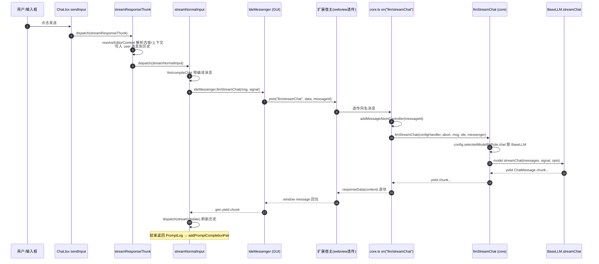

---
tags:
  - continue
  - llm
  - gui
  - ipc
  - callchain
created: 2026-10-23
---

# 07 - Continue 从页面 Chat 到 streamChat 的调用链路

> [!abstract] 一句话
> 用户在 GUI 聊天框点发送 → React thunk 解析内容 → 通过 webview `postMessage` 发出 message type **`"llm/streamChat"`** → core 侧 `on("llm/streamChat")` 接收 → `llmStreamChat()` 取出 `config.selectedModelByRole.chat`(即 `BaseLLM` 实例)→ `model.streamChat()` → `BaseLLM.streamChat` → `_streamChat`(或 openaiAdapter)。结果沿原路逐 chunk 流回页面。

相关笔记：[[00-Continue整体架构总图]]、[[02-Continue的Agent-Harness实现]]、[[06-Continue的OpenAI-Adapters协议转换]]

---

## 1. 全景时序图



---

## 2. 环节一：GUI 侧（React 前端）

### 2.1 入口 handler

`gui/src/pages/gui/Chat.tsx` → `sendInput`（约 159 行）

- 读取 redux 快照，取 `selectedModelByRole.chat`（约 160 行），无模型直接 return。
- 非 edit 模式下启动整条链路：
  ```ts
  void dispatch(streamResponseThunk({ editorState, modifiers, index })); // ~211 行
  ```

### 2.2 顶层 thunk：组织内容

`gui/src/redux/thunks/streamResponse.ts` → `streamResponseThunk`（18 行，action type `"chat/streamResponse"`）

- `selectSelectedChatModel(state)` 校验选中模型（~31 行）。
- `resolveEditorContent(...)` 解析输入文本 + 上下文项（~52 行）。
- `updateHistoryItemAtIndex(...)` 把 user 消息写进历史（~72 行）。
- `dispatch(streamNormalInput({...}))`（~84 行）进入真正的流式循环。
- 外层包 `streamThunkWrapper` 管理 streaming 状态。

### 2.3 调模型的循环体

`gui/src/redux/thunks/streamNormalInput.ts` → `streamNormalInput`

- 先 `llm/compileChat` 预编译得到 `compiledChatMessages`。
- 调用跨层接口（~199 行）：
  ```ts
  let gen = extra.ideMessenger.llmStreamChat(
    {
      completionOptions,
      title: selectedChatModel.title,
      messages: compiledChatMessages,
      legacySlashCommandData,
      messageOptions: { precompiled: true },
    },
    streamAborter.signal,
  );
  ```
- `while (!next.done)` 逐块 `dispatch(streamUpdate(next.value))`（~217-224 行）刷新对话历史；结束 `addPromptCompletionPair` 记录 PromptLog。
- 中止由 `state.session.streamAborter`（AbortSignal）驱动。

### 2.4 跨进程发送机制

`gui/src/context/IdeMessenger.tsx`

- `llmStreamChat`（249 行）→ `this.streamRequest("llm/streamChat", msg, cancelToken)`（253 行）。
- `streamRequest`（202 行）生成 `messageId`，用 `this.post("llm/streamChat", data, messageId)` 经 webview `postMessage` 发给扩展宿主；`window.addEventListener("message", handler)` 监听回包，把流式 chunk push 进 buffer 再 `yield`；收到 `responseData.done` 结束并返回 `returnVal`（PromptLog）。
- 中止时 `this.post("abort", undefined, messageId)`。

> [!important] 关键字符串
> GUI 发给 core 的 **message type = `"llm/streamChat"`**。整条链路靠它对接。

---

## 3. 环节二：消息协议层

`core/protocol/core.ts` → `ToCoreProtocol` 的 `"llm/streamChat"` 条目（约 221 行）：

```ts
"llm/streamChat": [
  { messages: ChatMessage[];
    completionOptions: LLMFullCompletionOptions;
    title: string;
    messageOptions?: MessageOption;
    legacySlashCommandData?: {...}; },
  AsyncGenerator<ChatMessage, PromptLog>,   // 返回类型:生成器
];
```

- 该消息在 `core/protocol/passThrough.ts` 列入透传名单；`extensions/vscode/src/webviewProtocol.ts` 识别其为 generator 类型，逐块回传给 GUI。

---

## 4. 环节三：core 侧接收 + 取出 model

### 4.1 注册点

`core/core.ts`

- `import { llmStreamChat } from "./llm/streamChat";`（77 行）
- 注册（约 563 行）：
  ```ts
  on("llm/streamChat", (msg) => {
    const abortController = this.addMessageAbortController(msg.messageId);
    return llmStreamChat(
      this.configHandler,
      abortController,
      msg,
      this.ide,
      this.messenger,
    );
  });
  ```
- `addMessageAbortController(messageId)` 建立该消息的 AbortController，供 GUI 的 `"abort"` 消息按 messageId 中止。

### 4.2 处理函数：选 model 并调用

`core/llm/streamChat.ts` → `llmStreamChat`（9 行）

- `const { config } = await configHandler.loadConfig();`（16 行）
- **取当前选中模型**：
  ```ts
  const model = config.selectedModelByRole.chat; // 32 行 —— 这就是 BaseLLM 实例
  if (!model) throw new Error("No chat model selected");
  ```
- 有 `legacySlashCommandData` 走 slash command 分支（调 `slashCommand.run`）；否则正常 chat 分支（约 115 行）：
  ```ts
  const gen = model.streamChat(
    messages,
    abortController.signal,
    completionOptions,
    messageOptions,
  );
  let next = await gen.next();
  while (!next.done) {
    if (abortController.signal.aborted) {
      next = await gen.return(errorPromptLog);
      break;
    }
    yield next.value; // 逐 chunk 向上游 yield(最终回到 GUI)
    next = await gen.next();
  }
  return next.value; // PromptLog
  ```

> [!note] model 从哪来
> `config.selectedModelByRole.chat` 由 ConfigHandler 根据用户在 config 里选的 provider 构造（见 [[00-Continue整体架构总图]]）。选 provider 发生在构造期，这里直接拿到现成的 `BaseLLM` 实例。

---

## 5. 环节四：最终落点 BaseLLM

`core/llm/index.ts`

### 5.1 `streamChat`（1095 行，公开入口）

- 应用 `applyToolOverrides` 做 per-model 工具覆盖（~1104 行）。
- `_parseCompletionOptions` 解析选项、建 interaction 日志（~1123 行）。
- `compileChatMessages` 按需编译消息（未 precompiled 时）。
- **核心分发**（~1189 行）：
  ```ts
  if (this.shouldUseOpenAIAdapter("streamChat") && this.openaiAdapter) {
    // 路径 A:走统一 adapter(toChatBody → openAIAdapterStream)  见 [[06-Continue的OpenAI-Adapters协议转换]]
  } else {
    for await (const chunk of this._streamChat(
      messages,
      signal,
      completionOptions,
    )) {
      // 1252 行
      const result = this.processChatChunk(chunk, interaction);
      yield result.chunk;
    }
  }
  ```
- 结束 `_logEnd` 记录；异常走 catch + `Logger.error`（~1286 行）。

### 5.2 `_streamChat`（1412 行，protected，默认实现）

```ts
protected async *_streamChat(messages, signal, options) {
  if (!this.templateMessages) {
    throw new Error("You must either implement templateMessages or _streamChat");
  }
  for await (const chunk of this._streamComplete(this.templateMessages(messages), signal, options)) {
    yield { role: "assistant", content: chunk };
  }
}
```

- 这是基类兜底：要么子类实现 `templateMessages` 退化走 `_streamComplete`，要么子类直接覆写 `_streamChat` 发真正网络请求（OpenAI / Anthropic 等 provider 子类）。

---

## 6. 一句话链路总览

```
Chat.tsx sendInput
  → dispatch(streamResponseThunk)          [gui/redux/thunks/streamResponse.ts]
  → streamNormalInput                       [gui/redux/thunks/streamNormalInput.ts]
  → ideMessenger.llmStreamChat              [gui/context/IdeMessenger.tsx]
  → streamRequest("llm/streamChat") → post  (webview postMessage)
  → [扩展宿主透传]
  → core.ts on("llm/streamChat")            [core/core.ts ~563]
  → llmStreamChat()                         [core/llm/streamChat.ts] 取 config.selectedModelByRole.chat
  → model.streamChat()                      [core/llm/index.ts ~1095]
  → BaseLLM._streamChat() / openaiAdapter   [core/llm/index.ts ~1412]
  →(provider 子类实现)→ 模型服务
```

流式结果沿原路逐 chunk `yield` 回 GUI，`streamUpdate` 实时刷新对话历史；结束返回 `PromptLog` 交给 `addPromptCompletionPair`。

---

## 关键源码位置

| 跳         | 文件                                        | 符号 / 行                                               |
| ---------- | ------------------------------------------- | ------------------------------------------------------- |
| GUI 入口   | `gui/src/pages/gui/Chat.tsx`                | `sendInput` ~159；dispatch ~211                         |
| 顶层 thunk | `gui/src/redux/thunks/streamResponse.ts`    | `streamResponseThunk` 18                                |
| 调模型循环 | `gui/src/redux/thunks/streamNormalInput.ts` | `streamNormalInput`；`llmStreamChat` ~199               |
| 跨层发送   | `gui/src/context/IdeMessenger.tsx`          | `llmStreamChat` 249；`streamRequest` 202                |
| 协议定义   | `core/protocol/core.ts`                     | `"llm/streamChat"` ~221                                 |
| core 注册  | `core/core.ts`                              | `on("llm/streamChat")` ~563                             |
| core 处理  | `core/llm/streamChat.ts`                    | `llmStreamChat` 9；取 model 32；`model.streamChat` ~115 |
| LLM 入口   | `core/llm/index.ts`                         | `streamChat` 1095                                       |
| LLM 落点   | `core/llm/index.ts`                         | `_streamChat` 1412                                      |
